# 🛒 HỆ THỐNG PHÂN KHÚC KHÁCH HÀNG BÁN LẺ (RETAIL CUSTOMER SEGMENTATION)
## 🏛️ Giai đoạn 1: Nạp Dữ Liệu Thô Từ POS Lên AWS S3 Data Lake (Bronze Layer)

---

## 📌 1. Bối cảnh Nghiệp vụ
- **Cửa hàng bán lẻ X**: Phát sinh các giao dịch mua hàng thiết yếu hàng ngày tại quầy thu ngân.
- **Nguồn dữ liệu thực tế**:
  1. `Transactions.csv`: Lịch sử từng lượt quét mã thanh toán của khách hàng (`Member_number`, `Date`, `productId`, `Items`).
  2. `Products_with_Categories.csv`: Danh mục sản phẩm, đơn giá niêm yết và phân loại ngành hàng.
- **Mục tiêu chặng hiện tại**: Thiết lập luồng đẩy dữ liệu thô (Raw Data Landing) từ máy POS lên tầng **S3 Bronze Bucket** an toàn, bảo mật và kiểm soát chi phí.

---

## 🏗️ 2. Sơ đồ Kiến trúc Chặng 1 (POS $\rightarrow$ AWS S3 Bronze)

Sơ đồ trực quan hóa duy nhất chặng đường từ quầy thu ngân đẩy dữ liệu lên S3 Bronze với mã màu chuẩn nhận diện AWS:

```mermaid
flowchart LR
    %% =========================================================================
    %% BẢNG MÃ MÀU VÀ ĐỊNH DẠNG THEO CHUẨN MERMAID-ARCHITECT & AWS PALETTE
    %% =========================================================================
    classDef actor fill:#FFFFFF,stroke:#232F3E,stroke-width:2px,color:#232F3E;
    classDef pos fill:#F8F9FA,stroke:#545B64,stroke-width:2px,color:#232F3E;
    classDef pipeline fill:#FFF3E0,stroke:#ED7100,stroke-width:2px,color:#C85100;
    classDef s3bronze fill:#3B48CC,stroke:#1A237E,stroke-width:2.5px,color:#FFFFFF;
    classDef security fill:#DD344C,stroke:#B71C1C,stroke-width:2px,color:#FFFFFF;
    classDef finops fill:#E7157B,stroke:#AD1457,stroke-width:2px,color:#FFFFFF;

    %% -------------------------------------------------------------------------
    %% CỘT 1: TÁC NHÂN CON NGƯỜI (HUMAN OPERATORS & USERS)
    %% -------------------------------------------------------------------------
    subgraph S1["1. TÁC NHÂN CON NGƯỜI (ACTORS)"]
        direction TB
        Cashier(["👤 Thu Ngân / Bán Hàng<br/><i>(Quét mã vạch & Thu tiền)</i>"]):::actor
        DE(["🧑‍💻 Data Engineer / DevOps<br/><i>(Vận hành Ingestion & IaC)</i>"]):::actor
        DS(["🧑‍🔬 Data Scientist<br/><i>(Nghiên cứu mô hình RFM)</i>"]):::actor
    end

    %% -------------------------------------------------------------------------
    %% CỘT 2: KHỞI TẠO HẠ TẦNG & NGUỒN POS CỬA HÀNG
    %% -------------------------------------------------------------------------
    subgraph S2["2. HẠ TẦNG & DỮ LIỆU CỬA HÀNG (ON-PREMISE POS)"]
        direction TB
        TF[["🟣 Terraform IaC Engine<br/><i>(infra/main.tf - Go SDK)</i>"]]:::pipeline
        TxData[("📄 Transactions.csv<br/><i>Member, Date, Items, Product</i>")]:::pos
        ProdData[("📄 Products_with_Categories.csv<br/><i>Catalog giá & Ngành hàng</i>")]:::pos
        IngestApp[["⚙️ Data Ingestion Pipeline<br/><i>Python Boto3 / TLS 1.3 Streaming</i>"]]:::pipeline
    end

    %% -------------------------------------------------------------------------
    %% CỘT 3: TẦNG ĐÁM MÂY AWS DATA LAKEHOUSE (US-EAST-1)
    %% -------------------------------------------------------------------------
    subgraph S3["3. AWS DATA LAKEHOUSE (REGION: US-EAST-1)"]
        direction TB
        BronzeBucket[("🪣 S3 Bronze Lakehouse<br/><b>retail-customer-lakehouse-...-bronze</b><br/><i>(Raw Landing Zone - CSV thô)</i>")]:::s3bronze

        subgraph S3_Guard["Bảo Vệ & Quản Trị Chi Phí"]
            direction LR
            SecLock["🔒 Block Public Access & AES-256"]:::security
            FinOps["🚨 CloudWatch Billing Alarm (1 USD)"]:::finops
        end
    end

    %% =========================================================================
    %% LUỒNG KẾT NỐI NGHIỆP VỤ & DỮ LIỆU
    %% =========================================================================
    DE ==>|"1. Khởi tạo hạ tầng Cloud (terraform apply)"| TF
    TF ==>|"2. Tạo Bucket & Cấu hình bảo mật"| BronzeBucket
    TF -.->|"Tạo chuông cảnh báo"| FinOps

    Cashier ==>|"3. Quẹt mã hóa đơn thanh toán"| TxData
    TxData --> IngestApp
    ProdData --> IngestApp
    DE ==>|"4. Chạy nạp dữ liệu"| IngestApp
    
    IngestApp ==>|"5. Upload file CSV qua SDK Boto3"| BronzeBucket
    BronzeBucket --- SecLock
    BronzeBucket -.->|"Giám sát chi phí lưu trữ"| FinOps
    BronzeBucket -.->|"Kéo dữ liệu mẫu phân tích"| DS
```

---

## 📂 3. Bảng Theo Dõi Tài Nguyên Hiện Tại

| Thành phần | Loại dịch vụ | Trạng thái hiện tại | Ý nghĩa kỹ thuật |
| :--- | :--- | :--- | :--- |
| **`POS Data`** | Tệp tin nguồn | Sẵn sàng tại `data/raw/` | 2 file thô chứa lịch sử giao dịch và danh mục giá. |
| **`Bronze Bucket`** | `aws_s3_bucket` | Đã khởi tạo bằng Terraform | Vùng hạ cánh dữ liệu thô (Landing Zone) tại `us-east-1`. |
| **`Block Public Access`** | `aws_s3_bucket_public_access_block` | Kích hoạt (Active) | Chặn 100% truy cập công khai ngoài Internet, bảo vệ PII khách hàng. |
| **`AES-256 Encryption`** | `aws_s3_bucket_server_side_encryption`| Kích hoạt (Active) | Dữ liệu được mã hóa tự động khi vừa ghi vào ổ cứng S3. |
| **`Spend Alert 1 USD`** | `aws_cloudwatch_metric_alarm` | Kích hoạt (Active) | FinOps Guardrail tự động báo động nếu chi phí vượt 1.00 USD. |

---

## 🚀 4. Bước Tiếp Theo
- Viết script Python Ingestion (`src/data_loader.py`) sử dụng thư viện `boto3` để tự động đẩy file từ `data/raw/` lên S3 Bronze Bucket.
