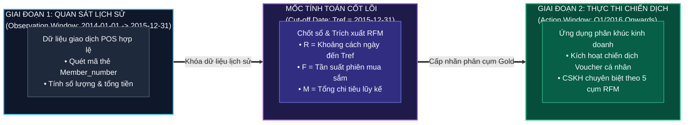

# 📋 BÁO CÁO GIAI ĐOẠN 1: UNDERSTAND BUSINESS PROBLEM

**Dự án**: Phân khúc Khách hàng Bán lẻ & Nền tảng Lakehouse (Retail Customer Segmentation & Lakehouse Platform)  
**Mã hồ sơ bàn giao**: `BUSINESS_BRIEF` (Trạm 1 trong Dây chuyền 13 Giai đoạn Data Science)  
**Đơn vị tiếp nhận**: Ban Giám đốc Khối Bán lẻ & Tiếp thị (Retail & Marketing Leadership)  
**Nhận đầu vào từ**: Chiến lược kinh doanh chuỗi bán lẻ & Dữ liệu giao dịch tại quầy POS  
**Bàn giao đầu ra cho**: `DATA_INVENTORY` (Trạm 2) & `EDA_FINDINGS` (Trạm 3)  
**Kiến trúc giải pháp**: AWS S3 Medallion Lakehouse (Bronze / Silver / Gold), Quản trị hạ tầng bằng mã (Terraform IaC)  
**Ngày lập báo cáo**: 2026-10-16  

---

## 1. TỔNG QUAN VẤN ĐỀ & PHÂN TÍCH GỐC RỄ (5 WHYS)

### 1.1. Tóm tắt vấn đề trong 5 câu
1. **Bối cảnh**: Cửa hàng bán lẻ X chuyên kinh doanh các mặt hàng tiêu dùng thiết yếu (rau, củ, quả, thịt, cá, trứng, sữa, đồ uống) với lượng khách hàng mua lẻ thường xuyên phát sinh qua hệ thống quầy thu ngân (POS).
2. **Nỗi đau (Pain Point)**: Hiện tại cửa hàng áp dụng chính sách tiếp thị đại trà "One-Size-Fits-All" (áp dụng chung một mức giảm giá, gửi thông báo khuyến mãi đồng loạt), dẫn tới chi phí khuyến mại cao nhưng tỷ lệ chuyển đổi đơn hàng thấp và không giữ chân được nhóm khách hàng trung thành.
3. **Mục tiêu**: Xây dựng hệ thống phân khúc khách hàng tự động dựa trên mô hình định lượng hành vi **RFM (Recency - Frequency - Monetary)** kết hợp thuật toán Học máy Không giám sát (**Unsupervised ML: K-Means, Hierarchical Clustering**).
4. **Giải pháp dự kiến**: Phân loại toàn bộ cơ sở khách hàng thành các nhóm chiến lược rõ rệt (*Champions, Loyal, Promising, At Risk, Dormant*) và đồng bộ nhãn phân cụm lên tầng AWS Gold Lakehouse để cấp dữ liệu trực tiếp cho hệ thống Marketing / CRM.
5. **Giá trị mang lại**: Tối ưu hóa ngân sách khuyến mãi, tăng doanh thu giỏ hàng trung bình (ARPU), giảm tỷ lệ rời bỏ của nhóm khách hàng giá trị cao và nâng cao mức độ hài lòng khách hàng thông qua trải nghiệm mua sắm cá nhân hóa.

---

### 1.2. Phân tích 5 Whys (Truy nguyên nguyên nhân cốt lõi)
1. **Tại sao doanh thu bán hàng chưa tối ưu và khách hàng có dấu hiệu rời bỏ?**  
   $\rightarrow$ Vì các chương trình ưu đãi, giảm giá và giới thiệu sản phẩm mới không đánh trúng nhu cầu của từng nhóm khách hàng riêng biệt.
2. **Tại sao chương trình ưu đãi không đánh trúng nhu cầu?**  
   $\rightarrow$ Vì bộ phận Marketing và Bán hàng đang đối xử với mọi khách hàng như nhau, gửi cùng một danh mục khuyến mãi cho cả người mới đến lần đầu lẫn người mua sắm hàng ngày.
3. **Tại sao lại đối xử với mọi khách hàng như nhau?**  
   $\rightarrow$ Vì cửa hàng chưa có một hệ thống hồ sơ khách hàng 360 độ (Customer 360 Profile) và chưa phân nhóm được tập khách hàng dựa trên hành vi tiêu dùng thực tế.
4. **Tại sao chưa phân nhóm được tập khách hàng?**  
   $\rightarrow$ Vì dữ liệu giao dịch quẹt mã tại quầy POS (`Transactions.csv`) và danh mục hàng hóa (`Products.csv`) chỉ được lưu trữ thô ở dạng tĩnh, chưa được xây dựng thành Data Pipeline tự động để tổng hợp các chỉ số hành vi định lượng (Recency, Frequency, Monetary).
5. **Tại sao dữ liệu chưa được tổng hợp định lượng? (NGUYÊN NHÂN GỐC RỄ)**  
   $\rightarrow$ Do thiếu một quy trình Data Science chuẩn mực từ tầng Data Lakehouse (Bronze $\to$ Silver $\to$ Gold) đến thuật toán Machine Learning Unsupervised để tự động phân cụm, đánh giá độ ổn định và chuyển giao chiến lược hành động thực tế cho vận hành.

---

### 1.3. Hiện trạng vận hành (Baseline nghiệp vụ)
- Cửa hàng phân loại khách hàng theo cảm tính của nhân viên thu ngân hoặc chỉ dựa vào tổng chi tiêu thô (khách mua đơn to thì coi là khách sỉ/VIP) mà bỏ qua hoàn toàn yếu tố **Recency (bao lâu rồi khách chưa quay lại)** và **Frequency (tần suất mua hàng đều đặn)**.
- Rất nhiều khách hàng từng mua đơn lớn trong quá khứ nhưng đã 6 tháng không quay lại (nhóm *At Risk / Churning*) vẫn bị xếp chung nhóm với khách hàng đang mua sắm tích cực tuần này.

---

### 1.4. Quyết định hành động thay đổi (Actionable Business Decision)
Sau khi mô hình phân cụm RFM được triển khai lên tầng AWS Gold Lakehouse:
- **Nhóm Marketing**: Không còn gửi tin nhắn SMS/Email khuyến mãi đại trà. Mỗi ngày hệ thống tự động lọc danh sách khách hàng theo cụm:
  - *Cụm Champions (R thấp, F cao, M cao)*: Gửi thiệp tri ân, tặng thẻ thành viên VIP độc quyền, quyền mua trước hàng tươi sống vụ sớm, **tuyệt đối không giảm giá xả hàng làm giảm giá trị thương hiệu**.
  - *Cụm At Risk (R cao, F cao, M cao - khách VIP sắp mất)*: Tự động kích hoạt chuỗi email / tin nhắn "Chúng tôi nhớ bạn" kèm voucher giảm giá 15% có thời hạn 7 ngày để lôi kéo khách quay lại quầy.
  - *Cụm New / Promising (R thấp, F thấp, M vừa)*: Gợi ý các sản phẩm bổ trợ (Cross-sell) thuộc danh mục tươi sống và sữa thiết yếu để xây dựng thói quen mua sắm hàng tuần.
  - *Cụm Dormant / Lost (R cao, F thấp, M thấp)*: Hạn chế tối đa chi phí quảng cáo để tránh lãng phí ngân sách tiếp thị.

---

## 2. MA TRẬN ĐỊNH LƯỢNG CHI PHÍ SAI LẦM (FP vs FN)

Trong bài toán Phân khúc Khách hàng Bán lẻ & Dự báo Rời bỏ (Customer Segmentation & Churn Risk), sai lầm phân loại gây ra các tổn thất tài chính cụ thể:

| Loại Sai Lầm | Mô Tả Tình Huống | Hậu Quả & Chi Phí Ước Tính | Trọng Số Ảnh Hưởng |
| :--- | :--- | :--- | :---: |
| **False Positive (FP)** | Mô hình gán nhầm khách hàng giá trị thấp (Low Value / Dormant) vào nhóm khách hàng giá trị cao (High Value / Champions). | **Lãng phí chi phí quà tặng & ưu đãi cao cấp**: Gửi quà tặng VIP, voucher giá trị cao cho khách chỉ mua hàng một lần rồi thôi. Ước tính thiệt hại: Chi phí quà tặng + chi phí vận hành tiếp thị $\approx 50.000 - 100.000$ VNĐ/khách hàng. | $C_{FP} = 1.0$ (Đơn vị cơ sở) |
| **False Negative (FN)** | Mô hình bỏ sót khách hàng VIP đang có nguy cơ rời bỏ (At Risk) sang nhóm khách hàng bình thường hoặc bỏ quên không chăm sóc. | **Mất vĩnh viễn khách hàng trung thành vào tay đối thủ**: Khách hàng trung thành đóng góp 70% doanh thu của cửa hàng. Khi mất 1 khách VIP, cửa hàng mất toàn bộ Giá trị Vòng đời Khách hàng (Customer Lifetime Value - CLV) trong tương lai. Ước tính mất mát: $2.000.000 - 5.000.000$ VNĐ/năm/khách. | $C_{FN} = 4.5$ |

- **Tỷ số đánh đổi**:
  $$Ratio = \frac{C_{FN}}{C_{FP}} \approx 4.5$$
- **Hệ quả chiến lược**: Sai lầm bỏ sót khách hàng quan trọng ($FN$) đắt gấp $4.5$ lần so với sai lầm gửi thừa ưu đãi ($FP$). Do đó, thuật toán phân cụm và tập luật RFM phải có cơ chế **bảo toàn tối đa nhận diện nhóm At Risk và High Value**, ưu tiên độ phủ (Recall) đối với các khách hàng có đóng góp doanh thu lớn.

---

## 3. KHUNG BÀI TOÁN MACHINE LEARNING & BẢN ĐỒ THỜI GIAN

### 3.1. Dịch bài toán sang Machine Learning
- **Loại bài toán ML**: **Học máy Không giám sát (Unsupervised Clustering) kết hợp Kỹ thuật Đặc trưng Phân tích RFM (Recency - Frequency - Monetary)**.
  - Tầng 1: Phân vị tứ phân vị (Quantile Binning $4 \times 4 \times 4 = 64$ phân khúc lý thuyết).
  - Tầng 2: Học máy phân cụm đa chiều (**K-Means**, **Hierarchical Clustering Agglomerative**, **Gaussian Mixture Models - GMM**).
  - Tầng 3: Đối sánh thuật toán nâng cao với **PySpark MLlib KMeans** (mô phỏng kiến trúc dữ liệu lớn phân tán).
- **Đơn vị dự báo / Thực thể phân tích (Prediction Grain)**:  
  **`1 dòng = 1 khách hàng duy nhất (Member_number)`** với vector đặc trưng 3 chiều $[R, F, M]$ được tổng hợp từ toàn bộ các giao dịch hợp lệ.
- **Định nghĩa toán học của bộ đặc trưng RFM**:
  1. **Recency ($R$)**: Số ngày tính từ lần mua sắm cuối cùng của khách hàng đến ngày mốc giả định của nghiên cứu ($T_{ref} = \max(\text{Date})$ trong tập giao dịch):
     $$R_i = \max_{j \in \mathcal{T}} (\text{Date}_j) - \max_{k \in \mathcal{T}_i} (\text{Date}_k)$$
  2. **Frequency ($F$)**: Tổng số lần (phiên giao dịch / ngày mua hàng) khách hàng $i$ phát sinh giao dịch:
     $$F_i = \text{CountDistinct}(\text{Date}_{i, k})$$
  3. **Monetary Value ($M$)**: Tổng số tiền thực tế khách hàng $i$ đã chi tiêu tại cửa hàng:
     $$M_i = \sum_{k \in \mathcal{T}_i} (\text{Quantity}_{i, k} \times \text{Price}_{i, k})$$

---

### 3.2. Bản đồ trục thời gian (Point-in-Time Mapping)
Để đảm bảo tính toàn vẹn thời gian, tránh rò rỉ dữ liệu (No-Leakage):

- **Kiểm toán nguồn rò rỉ dữ liệu tiềm tàng (Leakage Audit)**:
  - Cấm sử dụng các thông tin sau thời điểm $T_{ref}$ (ví dụ: các giao dịch trong tương lai) để tính toán $R, F, M$.
  - Khi join bảng sản phẩm: Giá sản phẩm (`price`) phải được lấy tại thời điểm giao dịch hoặc median ngành hàng, không dùng giá tương lai bị lạm phát.

---

## 4. CÂY PHÂN CẤP 3 TẦNG THƯỚC ĐO (METRIC HIERARCHY)

Để đảm bảo mô hình không chỉ là lý thuyết thuật toán mà tạo ra giá trị kinh doanh thực thụ, hệ thống thước đo được phân cấp thành 3 tầng:

| Tầng Thước Đo | Tên Chỉ Số | Công Thức / Đơn Vị Đo | Mục Tiêu & Ngưỡng Thành Công (Success Criteria) |
| :--- | :--- | :--- | :--- |
| **Tầng 1: Business Metric** (Giá trị kinh doanh thực) | **Incremental Revenue & Retention Rate** | - Tăng doanh thu giỏ hàng (+% ARPU) - Tỷ lệ kích hoạt lại nhóm At Risk (%) - Tỷ lệ đổi voucher thành công (Redemption Rate %) | - Doanh thu từ nhóm High-Value tăng $\ge 10\%$. - Kích hoạt lại ít nhất $\ge 8\%$ khách hàng At Risk. - Tỷ lệ đổi voucher cá nhân hóa đạt $\ge 15\%$ (so với $3\%$ của tiếp thị đại trà). |
| **Tầng 2: Model Metric chính** (Chất lượng phân cụm) | **Silhouette Score & Davies-Bouldin Index** | - Silhouette Score: $s \in [-1, 1]$ - Davies-Bouldin: $DBI \ge 0$ | - **Silhouette Score $\ge 0.55$** (Đảm bảo cụm tách biệt rõ ràng, khoảng cách nội cụm nhỏ và liên cụm lớn). - **Davies-Bouldin Index $\le 0.85$** (Cụm gọn gàng, ít chồng lấn). |
| **Tầng 3: Model Metric phụ** (Độ ổn định & Cân bằng) | **Cluster Stability & Size Distribution** | - Jaccard Stability Index qua Bootstrap ($B=100$ lần) - Calinski-Harabasz Index - Tỷ lệ kích thước cụm nhỏ nhất (%) | - **Jaccard Stability Index $\ge 0.80$** (Cụm ổn định khi lấy mẫu ngẫu nhiên). - Không có cụm dị biệt rác ($< 2\%$ tổng số khách) và không có cụm nuốt chửng ($> 65\%$). |

---

## 5. RÀNG BUỘC KỸ THUẬT & QUẢN TRỊ RỦI RO

### 5.1. Ràng buộc kỹ thuật & Triển khai
- **Chế độ thực thi**: **Batch Processing** định kỳ theo chu kỳ tuần/tháng (chạy off-peak vào 02:00 sáng Chủ Nhật) để cập nhật lại chỉ số RFM cho toàn bộ khách hàng.
- **Ràng buộc phần cứng**: Khóa trần **CPU $\le 75\%$** khi chạy Local, bộ nhớ RAM khả dụng đảm bảo không vượt quá $80\%$ trần an toàn.
- **Khả năng giải thích (Interpretability)**: Bắt buộc biểu diễn được hồ sơ cụm (Cluster Profiles) trên không gian trực quan hóa 2D/3D (Scatter Plot, Snake Plot / Parallel Coordinates, Radar Chart) để Ban Giám đốc và đội ngũ Marketing có thể hiểu rõ từng cụm ngay lập tức mà không cần kiến thức Machine Learning.
- **Tuân thủ FinOps**: Toàn bộ hạ tầng S3 Lakehouse và truy vấn Glue/Athena kiểm soát chặt chẽ trong hạn mức Free Tier và chuông báo động chi phí **1.00 USD**.

---

### 5.2. Kịch bản chia dữ liệu kiểm chứng (Validation Strategy)
Đối với bài toán Phân cụm Không giám sát (Unsupervised Clustering):
- **Không áp dụng kịch bản chia Train/Test ngẫu nhiên kiểu phân loại có giám sát** vì mục tiêu là phân khúc toàn bộ thực thể khách hàng hiện hữu để chăm sóc.
- **Chiến lược kiểm định tính ổn định (Cluster Stability Validation)**:
  - Áp dụng kỹ thuật **Sub-sampling & Bootstrap (100 lượt lấy mẫu 80% dữ liệu)**: Đo lường hệ số tương đồng Jaccard giữa các phân cụm để chứng minh cụm tìm được là cấu trúc tự nhiên của hành vi tiêu dùng, không phải do nhiễu ngẫu nhiên.
  - Kiểm tra độ bền vững qua thời gian (**Temporal Out-of-Time Stability**): Huấn luyện trên dữ liệu năm 2014, đánh giá độ ổn định của các phân khúc khi áp dụng lên dữ liệu năm 2015.

---

### 5.3. Bảng quản trị rủi ro toàn diện
| Rủi Ro Nhận Diện | Xác Suất | Tác Động | Biện Pháp Giảm Thiểu Cụ Thể |
| :--- | :---: | :---: | :--- |
| **Độ lệch phân phối quá lớn (Skewness / Extreme Outliers)** | Cao | Nghiêm trọng | Phân phối $F$ và $M$ trong bán lẻ luôn có độ lệch phải (Right-skewed) cực nặng do vài khách sỉ mua lớn. Áp dụng kỹ thuật chuyển đổi Log-transformation ($\log(1+x)$) hoặc Box-Cox/Yeo-Johnson trước khi đưa vào K-Means Euclidean distance. |
| **Giá sản phẩm bị thiếu trong danh mục (`missing price`)** | Trung bình | Vừa | Giao dịch có `productId` nhưng không tìm thấy giá trong `Products.csv`. Chốt chặn: Điền giá bằng Median của Category tương ứng, nếu không có Category thì lấy Median toàn hệ thống. |
| **Trùng lặp giao dịch (Duplicate Transactions)** | Trung bình | Vừa | Quẹt mã thanh toán 2 lần do lỗi mạng POS. Áp dụng Deduplication Pipeline khử trùng lặp theo cặp khóa `(Member_number, Date, productId)`. |
| **Khách hàng vãng lai không có mã (`Member_number` null)** | Thấp | Vừa | Lọc bỏ các bản ghi không định danh được khách hàng sang luồng phân tích lưu lượng giỏ hàng riêng, không nạp vào ma trận RFM cá nhân. |

---

## 6. ĐỀ XUẤT KIẾN TRÚC KỸ THUẬT NÂNG CAO CHO MÔ HÌNH SẢN XUẤT (ADVANCED PRODUCTION ARCHITECTURE)

Để đảm bảo mô hình phân cụm đạt độ phân ly cao ($s \ge 0.55$) và có tính ứng dụng thực chiến trong môi trường bán lẻ, các giải pháp kỹ thuật cốt lõi sau được đề xuất triển khai:

| STT | Giải Pháp Kỹ Thuật Đề Xuất | Mức Độ Ưu Tiên | Giá Trị Kỹ Thuật & Nghiệp Vụ Đem Lại | Cách Thức Triển Khai Trong Pipeline |
| :---: | :--- | :---: | :--- | :--- |
| **1** | **RFM Quantile Rule-based Segmentation (Tập luật 64 Phân Khúc Tứ Phân Vị)** | 🔴 **Bắt buộc** | Tạo đường cơ sở nghiệp vụ (Domain Baseline) cực mạnh: Chia mỗi trục $R, F, M$ thành 4 bins $(1-4) \to 64$ nhóm, làm thước đo đối chiếu bắt buộc cho thuật toán K-Means. | Dùng hàm `pd.qcut` với rank method thích ứng xử lý giá trị trùng lặp. |
| **2** | **Power Transformation & Robust Outlier Pre-scaling** | 🔴 **Bắt buộc** | Thuật toán K-Means sử dụng khoảng cách Euclidean cực kỳ nhạy cảm với Outliers và phân phối lệch. Chuyển đổi Log hoặc Yeo-Johnson trước khi chuẩn hóa là điều kiện tiên quyết để phân cụm không bị méo. | `sklearn.preprocessing.PowerTransformer` kết hợp `StandardScaler`. |
| **3** | **Snake Plot & Radar Visualization for Cluster Interpretation** | 🟡 **Nên có** | Trực quan hóa giá trị trung bình chuẩn hóa của từng cụm trên cùng một đồ thị đường (Snake Plot) giúp đội ngũ kinh doanh đọc vị ngay đặc tính cụm mà không cần am hiểu ML. | `seaborn.lineplot` và `plotly.graph_objects.Scatterpolar`. |

---

## 7. CÂU HỎI TỒN ĐỌNG & KẾ HOẠCH BÀN GIAO TIẾP THEO

### 7.1. Câu hỏi Tồn đọng cho Stakeholder
1. **Chính sách Thẻ Thành viên**: Cửa hàng X có áp dụng chính sách điểm thưởng (Loyalty Points) hay hạn sử dụng tài khoản thành viên sau 12 tháng không mua hàng hay không?
2. **Biên lợi nhuận ngành hàng**: Có danh sách chi phí biên (Margin %) của từng ngành hàng để tích hợp vào trọng số Monetary hay sử dụng doanh thu thuần thô?

### 7.2. Kế hoạch Bàn giao Trạm Kế tiếp
- **Đầu ra bàn giao**: Khung bài toán phân khúc RFM, ma trận chi phí sai lầm ($C_{FN} / C_{FP} \approx 4.5$), hệ thống thước đo 3 tầng và các ràng buộc kỹ thuật không rò rỉ dữ liệu.
- **Trạm tiếp quản**: 
  - `DATA_INVENTORY` (Trạm 2): Kiểm kê chi tiết 2 tệp dữ liệu thô (`Transactions.csv`, `Products_with_Categories.csv`), đối soát tính toàn vẹn và kiểm tra phân phối ban đầu trên AWS S3 Bronze.
  - `EDA_FINDINGS` (Trạm 3): Khám phá dữ liệu thô đa tầng (đơn biến, 2 biến, đa biến) trước khi làm sạch.

