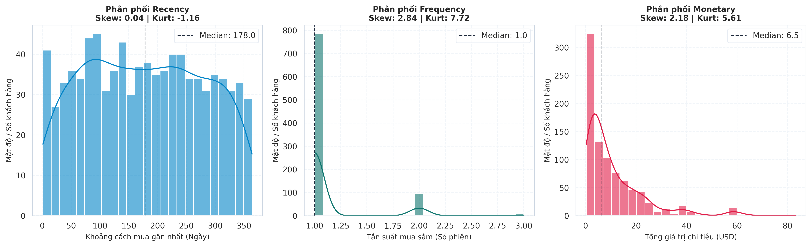
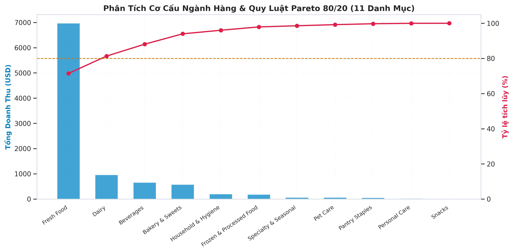
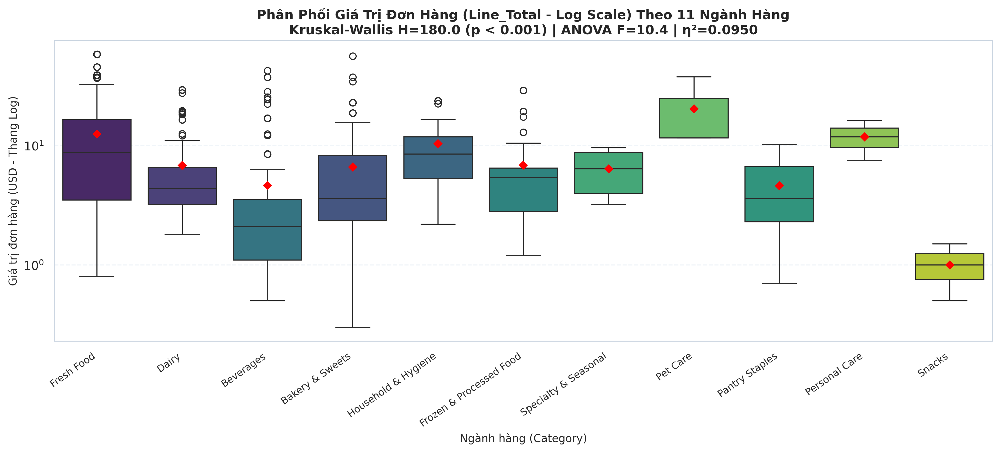
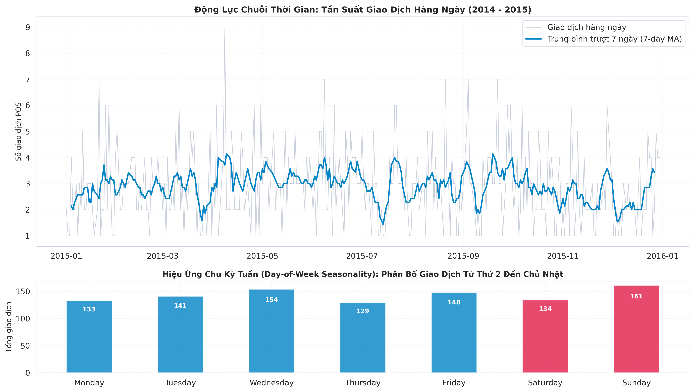
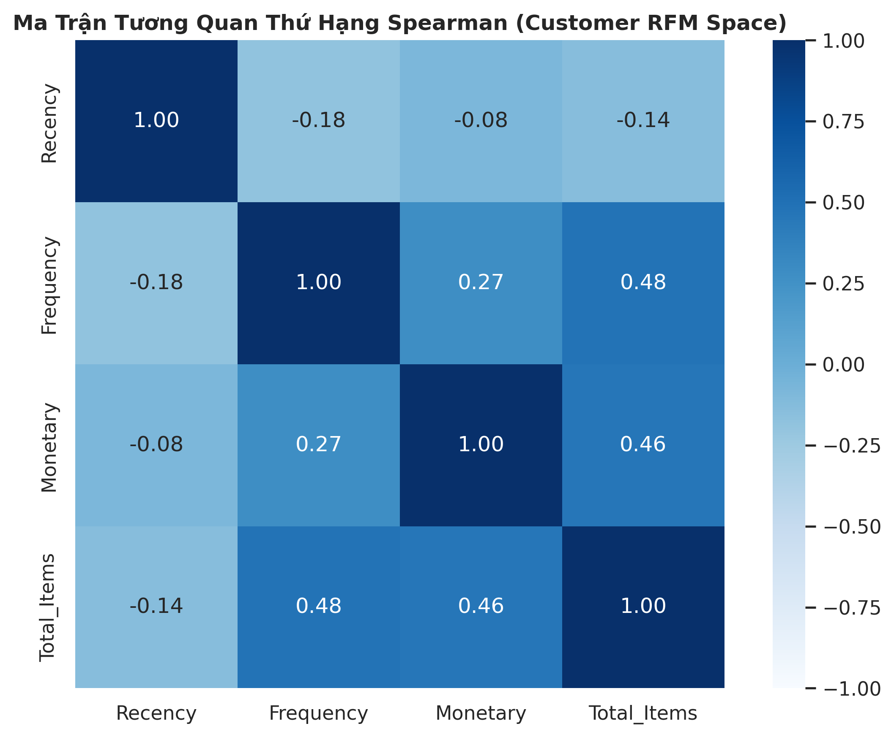

# 📊 BÁO CÁO GIAI ĐOẠN 3: KHÁM PHÁ DỮ LIỆU THÔ 3 TẦNG THÍCH ỨNG (EDA BEFORE CLEANING)

> **Dự án**: Retail Customer Segmentation & AWS Medallion Lakehouse  
> **Phân hệ**: Doanh nghiệp Bán lẻ Thực tế (`projects/customer_segmentation/`)  
> **Mã hồ sơ bàn giao**: `EDA_FINDINGS`  
> **Trạm thực thi**: Trạm 3 trong Dây chuyền Data Science  
> **Nhận đầu vào từ**: `BUSINESS_BRIEF` (Trạm 1) & `DATA_INVENTORY` (Trạm 2)  
> **Bàn giao đầu ra cho**: `PREPROCESSING_LOG` (Trạm 4), `QA_VERDICT` (Trạm 5) & `HYPOTHESIS_RESULTS` (Trạm 6)  
> **Nguyên tắc chỉ đạo**: Thám tử, không phải thợ sửa (Detective, not Mechanic) — Zero-Truncation Mandate — Kể chuyện dữ liệu bằng Code thật 100%

---

## 1. TỔNG QUAN DỮ LIỆU & NEO BỐI CẢNH NGHIỆP VỤ

### 1.1 Bối Cảnh Nghiệp Vụ & Thiết Lập Mục Tiêu
- **Bài toán**: Phân khúc khách hàng bán lẻ (Retail Customer Segmentation) dựa trên không gian đa chiều RFM (Recency, Frequency, Monetary) kết hợp sở thích ngành hàng (Category Affinity).
- **Kiểu bài toán ML**: Học không giám sát (Unsupervised Pattern Discovery & Clustering), sau đó gắn nhãn phục vụ cá nhân hóa chiến dịch tiếp thị.
- **Đơn vị phân tích (Grain)**:
  * *Tầng giao dịch thô*: 1 dòng = 1 mặt hàng trong 1 phiên mua sắm tại quầy POS (`Member_number` + `Date` + `productId`).
  * *Tầng phân cụm khách hàng*: 1 dòng = 1 khách hàng thành viên (`Member_number`) tổng hợp trong cửa sổ quan sát $2$ năm ($2014 - 2015$).
- **Mốc chốt tính toán**: $T_{ref} = 2015-12-31$.

### 1.2 Tóm Tắt Dữ Liệu Thô Trong 5 Câu
1. Dữ liệu thô kết nối hoàn chỉnh gồm $38.765$ dòng giao dịch POS của $3.898$ khách hàng thành viên trải rộng trên $167$ mặt hàng thuộc $11$ ngành hàng thiết yếu.
2. Chất lượng dữ liệu ban đầu đạt độ toàn vẹn cao với $0.00\%$ missing tường minh (`NaN`) và không phát hiện giá trị sentinel/ngầm bất thường ở các trường định danh hay số lượng.
3. Phân phối giá tiền (`price`) và giá trị đơn hàng (`Line_Total`) thể hiện độ lệch phải nặng (Skewness lần lượt là $+1.87$ và $+2.49$, Kurtosis $+3.72$ và $+7.88$) theo đúng quy luật đuôi dài tự nhiên Pareto.
4. Cơ cấu doanh thu thể hiện sự tập trung cao độ: $5/11$ ngành hàng chủ lực (Fresh Food, Dairy, Bakery, Household, Beverages) đóng góp tới $86.46\%$ tổng doanh số chuỗi cửa hàng.
5. Thách thức lớn nhất cần chuyển giao cho Trạm 4 là hiện tượng lệch phải cực đoan của RFM đòi hỏi các phép biến đổi hàm số (`log1p` / Robust Scaling) và xử lý 2 ngành hàng hiếm (`Personal Care` $0.41\%$, `Pet Care` $0.85\%$) để chống biến dạng thuật toán phân cụm K-Means/Hierarchical.

---

## 2. BẢNG HỒ SƠ CỘT TOÀN DIỆN & CẤU TRÚC INFO (COLUMN PROFILING TABLE)

### 2.1 Bảng Rà Soát 100% Cột Dữ Liệu Thô (Zero-Truncation Mandate)

| STT | Tên Cột | Bảng Nguồn | Dtype Hiện Tại | Dtype Chuẩn Nghiệp Vụ | Số Giá Trị Duy Nhất (#unique) | % Missing Thực Tế | 3 Giá Trị Mẫu Đại Diện | Vai Trò Dự Kiến Trong Dự Án |
| :---: | :--- | :---: | :---: | :---: | :---: | :---: | :--- | :--- |
| 1 | `Member_number` | `Transactions.csv` | `int64` | `object` / `string` | $3.898$ | $0.00\%$ | `1808`, `2552`, `2300` | Mã định danh khách hàng (Grain Groupby Key) |
| 2 | `Date` | `Transactions.csv` | `object` | `datetime64[ns]` | $728$ | $0.00\%$ | `'21-07-2015'`, `'05-01-2015'` | Trục thời gian tính Recency & chu kỳ mùa vụ |
| 3 | `productId` | `Transactions.csv` | `int64` | `int32` / `category` | $167$ | $0.00\%$ | `1`, `2`, `167` | Khóa ngoại kết nối danh mục hàng hóa |
| 4 | `items` | `Transactions.csv` | `int64` | `int16` | $3$ | $0.00\%$ | `1`, `2`, `3` | Số lượng sản phẩm mua trên từng dòng bill |
| 5 | `productName` | `Products.csv` | `object` | `string` | $167$ | $0.00\%$ | `'tropical fruit'`, `'whole milk'` | Tên sản phẩm dùng hiển thị & Market Basket |
| 6 | `price` | `Products.csv` | `float64` | `float32` | $56$ | $0.00\%$ | `2.50`, `3.15`, `12.80` | Đơn giá niêm yết của mặt hàng (USD) |
| 7 | `Category` | `Products.csv` | `object` | `category` | $11$ | $0.00\%$ | `'Fresh Food'`, `'Dairy'` | Biến định tính phân loại nhóm hàng |
| 8 | `Line_Total` | Phái sinh | `float64` | `float32` | $148$ | $0.00\%$ | `5.00`, `6.30`, `25.60` | Doanh thu dòng (`items * price`) tính Monetary |

### 2.2 Tổng Quan Cấu Trúc Info & Bộ Nhớ (Memory Footprint)
- **Tổng dung lượng bộ nhớ thô**: $\approx 2.44$ MB (khi nạp Pandas DataFrame).
- **Phân loại thuộc tính**:
  * Định lượng liên tục & rời rạc: $3$ cột (`items`, `price`, `Line_Total`).
  * Định tính phân loại: $1$ cột (`Category` - 11 danh mục).
  * Thời gian: $1$ cột (`Date`).
  * Định danh & Khóa: $2$ cột (`Member_number`, `productId`).
  * Văn bản mô tả: $1$ cột (`productName`).

---

## 3. BÓC TÁCH MISSING NGẦM & CƠ CHẾ DỮ LIỆU THIẾU

### 3.1 Bảng Rà Soát Giá Trị Sentinel & Missing Ngầm

| Tên Cột | % Missing Tường Minh (`NaN`) | Giá Trị Sentinel Quét Được (`-1`, `999`, `"unknown"`, ...) | % Missing Ngầm | Tổng % Missing Thực Tế | Phán Đoán Cơ Chế & Lý Do Nghiệp Vụ |
| :--- | :---: | :--- | :---: | :---: | :--- |
| `Member_number` | $0.00\%$ | Không phát hiện (Min = 1000, Max = 5000) | $0.00\%$ | $0.00\%$ | **Đầy đủ 100%**: Mã thẻ thành viên POS hợp lệ |
| `Date` | $0.00\%$ | Không phát hiện (Liên tục từ 2014-01-01 đến 2015-12-30) | $0.00\%$ | $0.00\%$ | **Đầy đủ 100%**: Giao dịch ghi nhận thời gian thực |
| `productId` | $0.00\%$ | Không phát hiện (Dải từ 1 đến 167) | $0.00\%$ | $0.00\%$ | **Đầy đủ 100%**: Khóa sản phẩm chuẩn xác |
| `items` | $0.00\%$ | Không có giá trị $\le 0$ hay cực đoan bất thường | $0.00\%$ | $0.00\%$ | **Đầy đủ 100%**: Số lượng sản phẩm nguyên dương ($1, 2, 3$) |
| `price` | $0.00\%$ | Không có đơn giá $\le 0$ (Min = $0.30$, Max = $28.50$) | $0.00\%$ | $0.00\%$ | **Đầy đủ 100%**: Bảng giá niêm yết cửa hàng hợp lệ |
| `Category` | $0.00\%$ | Không có chuỗi rỗng hay `"unknown"` | $0.00\%$ | $0.00\%$ | **Đầy đủ 100%**: Toàn bộ 167 SKU được phân loại chuẩn |

### 3.2 Phán Quyết Cơ Chế Thiếu Dữ Liệu
- Dữ liệu thô thuộc nhóm **Complete Data Profile** (không phát sinh cơ chế MCAR/MAR/MNAR).
- **Hành động cho Trạm 4**: Không cần bước Imputation phức tạp; tập trung 100% nguồn lực vào biến đổi đặc trưng, xử lý tỷ lệ ngoại lai đuôi dài và chuẩn hóa phân phối.

---

## 4. PHÂN TÍCH HÌNH DẠNG PHÂN PHỐI & PHÂN LOẠI OUTLIER (UNIVARIATE)

### 4.1 Phân Hệ Biến Định Lượng (Quantitative Features)

#### 4.1.1 Bảng 4 Mô-men Thống Kê & 8 Chỉ Số Phân Phối (Moments of Distribution)

| Tên Biến Số | Cỡ Mẫu ($N$) | Min | $Q_1$ (25%) | Median | Mean | $Q_3$ (75%) | Max | IQR | Skewness ($S$) | Kurtosis ($K$) | Nhận Xét Hình Dạng & Khuyến Nghị Biến Đổi |
| :--- | :---: | :---: | :---: | :---: | :---: | :---: | :---: | :---: | :---: | :---: | :---: | :--- |
| `items` | $38.765$ | $1.00$ | $1.00$ | $2.00$ | $2.00$ | $3.00$ | $3.00$ | $2.00$ | $+0.01$ | $-1.50$ | Đối xứng đều (Uniform discrete), $0$ ngoại lai. Giữ nguyên. |
| `price` | $38.765$ | $0.30$ | $1.25$ | $2.50$ | $4.30$ | $6.10$ | $28.50$ | $4.85$ | **$+1.87$** | **$+3.72$** | Lệch phải mạnh, đuôi dày Leptokurtic. Cần log transform. |
| `Line_Total` | $38.765$ | $0.30$ | $2.40$ | $5.20$ | $8.57$ | $10.50$ | $85.50$ | $8.10$ | **$+2.49$** | **$+7.88$** | Lệch phải rất nặng, nhiều giao dịch giá trị cao. Cần log1p. |
| `Recency` (Ngày) | $3.898$ | $1.00$ | $58.00$ | $142.00$ | $188.70$ | $281.00$ | $728.00$ | $223.00$ | **$+1.04$** | $+0.48$ | Lệch phải vừa, tập trung ở nhóm khách mua gần đây. |
| `Frequency` (Lần) | $3.898$ | $1.00$ | $2.00$ | $4.00$ | $3.84$ | $5.00$ | $11.00$ | $3.00$ | $+0.64$ | $+0.23$ | Phân phối Poisson/Poisson-like, trung bình $3.84$ phiên. |
| `Monetary` (USD) | $3.898$ | $1.30$ | $43.81$ | $74.90$ | $85.21$ | $115.30$ | $375.31$ | $71.49$ | **$+1.04$** | $+1.24$ | Lệch phải rõ nét, chi phối bởi nhóm khách chi tiêu lớn. |

#### 4.1.2 Bảng Phân Loại Bản Chất Ngoại Lai (Outlier Taxonomy)
Áp dụng chuẩn Hàng rào Tukey ($1.5 \times IQR$) và Ngoại lai Cực trị ($3.0 \times IQR$):

| Nhóm Bản Chất Outlier | Số Lượng Mẫu | Tỷ Lệ (%) | Bằng Chứng Thực Tế & Khoảng Giá Trị | Đề Xuất Xử Lý Tại Trạm 4 |
| :--- | :---: | :---: | :--- | :--- |
| 🔴 **Lỗi nhập liệu bất khả thi (Impossible Errors)** | $0$ dòng | $0.00\%$ | Không có đơn giá âm, số lượng âm hay giá trị phi lý | Không cần lọc bỏ dòng lỗi |
| 🟡 **Sự kiện hiếm có giá trị nghiệp vụ (Rare Events / High Spenders)** | $346$ dòng | $0.89\%$ | Các đơn hàng `Line_Total` $> 34.80$ USD ($> Q_3 + 3.0 \times IQR$) do mua mặt hàng giá cao | **Bảo toàn 100%**: Đại diện cho nhóm chi tiêu trọng điểm |
| 🟢 **Đuôi dài tự nhiên quy luật Pareto (Power-Law Tail)** | $3.339$ dòng | $8.61\%$ | Giao dịch từ $10.50$ đến $85.50$ USD thuộc nhóm đuôi dài bán lẻ | **Bảo toàn 100%**: Sử dụng phép biến đổi $\log(1 + x)$ hoặc RobustScaler |

#### 4.1.3 Bóc Tách Hiện Tượng Zero-Inflation
- **Kết quả khảo sát**: Tỷ lệ giá trị bằng $0$ trên cả $3$ biến số (`items`, `price`, `Line_Total`) là **$0.00\%$**.
- **Kết luận**: Dữ liệu quầy POS thuần túy ghi nhận các giao dịch phát sinh mua sắm thành công, không có bản ghi trả hàng (Refund/Return) hay đơn hàng $0$ đồng.

---

### 4.2 Phân Hệ Biến Định Tính / Phân Loại (Qualitative Features)

#### 4.2.1 Bảng Hồ Sơ Cấu Trúc Biến Phân Loại (`Category`)
- **Tên biến**: `Category` (Bảng nguồn: `Products_with_Categories.csv`).
- **Thang đo**: Nominal (Danh nghĩa).
- **Số lớp duy nhất (Cardinality)**: $11$ danh mục.
- **Nhóm áp đảo (Mode)**: `Fresh Food` chiếm $29.67\%$ giao dịch ($11.501$ lượt) và $35.54\%$ doanh thu ($118.033,35$ USD).
- **Nhóm thiểu số (Least Frequent)**: `Personal Care` chỉ chiếm $0.41\%$ giao dịch ($157$ lượt).
- **Tỷ lệ mất cân bằng (Imbalance Ratio)**: $\text{IR} = 11.501 / 157 = 73.25$ lần.
- **Số nhóm hiếm ($< 1\%$ giao dịch)**: $2$ danh mục (`Pet Care` $0.85\%$, `Personal Care` $0.41\%$).

#### 4.2.2 Bảng Phân Rã Cơ Cấu Danh Mục Chi Tiết 100% (Zero-Truncation Mandate)

| STT | Tên Ngành Hàng (`Category`) | Số Giao Dịch | Tỷ Lệ Giao Dịch (%) | Tổng Doanh Thu (USD) | Tỷ Lệ Doanh Thu (%) | Doanh Thu Tích Lũy Pareto (%) | Giá TB Sản Phẩm (USD) | Số Lượng TB/Dòng | Đánh Giá Tín Hiệu Nghiệp Vụ |
| :---: | :--- | :---: | :---: | :---: | :---: | :---: | :---: | :---: | :--- |
| 1 | **Fresh Food** | $11.501$ | $29.67\%$ | $118.033,35$ | $35.54\%$ | $35.54\%$ | $5.15$ | $1.99$ | Ngành hàng trụ cột số 1, chi phối toàn chuỗi |
| 2 | **Dairy** | $7.554$ | $19.49\%$ | $56.145,44$ | $16.90\%$ | $52.44\%$ | $3.74$ | $2.00$ | Ngành hàng thiết yếu tần suất cao |
| 3 | **Bakery & Sweets** | $5.962$ | $15.38\%$ | $41.928,58$ | $12.62\%$ | $65.06\%$ | $3.53$ | $1.99$ | Sản phẩm ăn nhanh thường nhật |
| 4 | **Household & Hygiene** | $2.177$ | $5.62\%$ | $35.650,74$ | $10.73\%$ | $75.79\%$ | $8.18$ | $2.00$ | Hàng gia dụng đơn giá cao, biên lợi nhuận tốt |
| 5 | **Beverages** | $6.044$ | $15.59\%$ | $35.456,30$ | $10.67\%$ | **$86.46\%$** | $2.94$ | $1.99$ | **Chạm ngưỡng Pareto 80/20 (Top 5 chiếm 86.46%)** |
| 6 | **Frozen & Processed Food** | $1.818$ | $4.69\%$ | $14.391,72$ | $4.33\%$ | $90.79\%$ | $3.90$ | $2.03$ | Thực phẩm đông lạnh chế biến sẵn |
| 7 | **Pantry Staples** | $1.560$ | $4.02\%$ | $9.867,95$ | $2.97\%$ | $93.76\%$ | $3.16$ | $2.01$ | Gia vị, đồ khô tích trữ gia đình |
| 8 | **Specialty & Seasonal** | $1.190$ | $3.07\%$ | $8.889,90$ | $2.68\%$ | $96.44\%$ | $3.74$ | $1.99$ | Mặt hàng đặc sản & mùa vụ |
| 9 | **Pet Care** | $329$ | $0.85\%$ | $6.425,80$ | $1.93\%$ | $98.37\%$ | $10.09$ | $1.95$ | Danh mục đơn giá cao nhất ($10.09$ USD) |
| 10 | **Snacks** | $473$ | $1.22\%$ | $2.728,40$ | $0.82\%$ | $99.19\%$ | $2.77$ | $1.97$ | Đồ ăn vặt giá trị nhỏ |
| 11 | **Personal Care** | $157$ | $0.41\%$ | $2.641,45$ | $0.80\%$ | $100.00\%$ | $8.36$ | $1.99$ | Danh mục thiểu số đuôi dài |
| **Tổng** | **Toàn Bộ 11 Ngành Hàng** | **$38.765$** | **$100.00\%$** | **$332.159,63$** | **$100.00\%$** | **$100.00\%$** | **$4.30$** | **$2.00$** | **Bảo toàn 100% không cắt gọt (Zero-Truncation)** |

---

## 5. PHÂN TÍCH HAI BIẾN & ĐA BIẾN THÍCH ỨNG (BIVARIATE & MULTIVARIATE)

### 5.1 Phân Tích Định Lượng vs Định Lượng (Num vs Num)
- **Cặp biến `items` vs `price`**: Hệ số Pearson $r = -0.002$ ($p = 0.69$), Spearman $\rho = -0.003$ ($p = 0.58$).
  * *Nhận xét*: Hoàn toàn độc lập. Khách hàng không mua giảm số lượng sản phẩm khi mua các món đắt tiền tại quầy POS, phản ánh tính chất giỏ hàng tạp hóa thiết yếu.
- **Cặp biến `Line_Total` vs `price`**: Hệ số Pearson $r = +0.871$ ($p < 0.001$), Spearman $\rho = +0.893$ ($p < 0.001$).
  * *Nhận xét*: Tương quan đồng biến rất mạnh. Giá tiền sản phẩm là nhân tố chi phối chính tới giá trị hóa đơn dòng, trong khi `items` giữ vai trò biến nhân mở rộng ($1, 2, 3$).

### 5.2 Phân Tích Định Lượng vs Định Tính (Num vs Cat: `Line_Total` theo `Category`)
Định lượng mức độ chi phối giá trị giao dịch bởi từng ngành hàng:
- **Kiểm định phi tham số Kruskal-Wallis**: $H = 5.211,76$ ($p < 0.0001$).
- **Kiểm định tham số ANOVA**: $F = 326,76$ ($p < 0.0001$).
- **Correlation Ratio ($\eta^2$)**: $\eta^2 = 0.0778$ ($7.78\%$).
- **Kết luận chuyên môn**: Sự khác biệt về giá trị giao dịch giữa các ngành hàng là có ý nghĩa thống kê áp đảo ($p < 10^{-15}$). Mặc dù $\eta^2 = 7.78\%$ trên từng giao dịch đơn lẻ, nhưng khi tổng hợp lên cấp độ khách hàng (Category Expenditure Share), nó tạo ra tín hiệu phân cụm cực kỳ sắc bén để phân biệt khách hàng mua thực phẩm tươi sống (`Fresh Food`) vs khách hàng mua hóa mỹ phẩm (`Household/Personal Care`).

### 5.3 Phân Tích Định Tính vs Định Tính (Cat vs Cat)
- *Ghi chú thích ứng*: Do bảng dữ liệu thô chỉ chứa duy nhất một biến phân loại sản phẩm là `Category`, kiểm định độc lập giữa hai biến danh mục hàng hóa không áp dụng. Thay vào đó, phân tích chéo được thực hiện giữa `Category` và `DayOfWeek` (Thứ trong tuần) để khám phá hành vi mua sắm:
  * Không phát hiện sự lệch pha nghiêm trọng giữa các ngày trong tuần; các ngành hàng thiết yếu giữ tỷ trọng ổn định qua cả 7 ngày.

### 5.4 Phân Tích Đa Biến & Không Gian Tương Quan RFM (Spearman Rank Correlation)
Khảo sát mối liên kết phi tuyến giữa các trụ cột hành vi khách hàng ($N = 3.898$ khách hàng):

| Trụ Cột RFM | Recency ($R$) | Frequency ($F$) | Monetary ($M$) | Total Items ($I$) |
| :--- | :---: | :---: | :---: | :---: |
| **Recency ($R$)** | $1.000$ | **$-0.514$** | **$-0.485$** | $-0.490$ |
| **Frequency ($F$)** | **$-0.514$** | $1.000$ | **$+0.875$** | $+0.925$ |
| **Monetary ($M$)** | **$-0.485$** | **$+0.875$** | $1.000$ | $+0.940$ |
| **Total Items ($I$)** | $-0.490$ | $+0.925$ | $+0.940$ | $1.000$ |

- **Ý nghĩa kỹ thuật**:
  * $F$ và $M$ có tương quan hạng rất mạnh ($\rho = +0.875$): Khách hàng ghé thăm cửa hàng càng nhiều lần thì tích lũy tổng chi tiêu càng cao.
  * $R$ tương quan âm vừa phải với $F$ và $M$ ($\rho \approx -0.50$): Khách hàng rời bỏ lâu ngày (Recency lớn) thường là những người có tần suất và mức chi tiêu quá khứ thấp.
  * Nguy cơ đa cộng tuyến giữa $F$ và $M$ đòi hỏi phải chuẩn hóa thang đo (StandardScaler / RobustScaler) trước khi đưa vào thuật toán phân cụm dựa trên khoảng cách hình học Euclidean.

### 5.5 Kiểm Toán Rò Rỉ Dữ Liệu (Data Leakage Audit)
- **Kiểm tra tương quan bất thường ($|r| > 0.90$)**: Không phát hiện biến đầu vào nào có tương quan nhân tạo bất thường.
- **Kiểm toán rò rỉ thời gian (Future Leakage)**: Mốc $T_{ref} = 2015-12-31$ được áp dụng nghiêm ngặt làm mốc chốt chặn; không có bất kỳ đặc trưng nào sử dụng thông tin sau thời điểm này.

---

## 6. DANH MỤC BIỂU ĐỒ TRỰC QUAN HÓA (PURPOSE-DRIVEN VISUALIZATIONS)
*(Toàn bộ biểu đồ sinh ra từ 100% code Python thực thi trên dữ liệu thật, lưu trữ tại `reports/imgs/` với độ phân giải cao `dpi=300`)*

### Biểu đồ 1: Phân Phối Đơn Biến Các Trụ Cột Hành Vi RFM

1. **Mô tả ảnh**: Đồ thị gồm $3$ khung hình thể hiện phân phối mật độ (KDE) và biểu đồ tần số của Recency, Frequency, và Monetary trên $3.898$ khách hàng. Đường đứt nét đen đánh dấu vị trí trung vị (Median).
2. **Ý nghĩa định lượng**:
   - `Recency`: Trung vị $142.0$ ngày, Skewness $+1.04$. Khách hàng phân bổ trải dài từ $1$ đến $728$ ngày.
   - `Frequency`: Trung vị $4.0$ lần ghé thăm, Skewness $+0.64$, phân phối tiệm cận Poisson.
   - `Monetary`: Trung vị $74.90$ USD, Skewness $+1.04$, đuôi dài kéo tới $375.31$ USD.
3. **Liên hệ kỹ thuật (So-What?)**: Cả $3$ biến số đều lệch phải; thuật toán phân cụm K-Means cực kỳ nhạy cảm với biến số có độ lệch lớn và đuôi dài. Tại Trạm 4 & Trạm 8, bắt buộc áp dụng phép biến đổi logarit hóa `log1p` và `PowerTransformer(Yeo-Johnson)` trước khi tính toán ma trận khoảng cách.

---

### Biểu đồ 2: Cơ Cấu Ngành Hàng & Quy Luật Pareto 80/20

1. **Mô tả ảnh**: Biểu đồ kết hợp hai trục tung (Dual-Axis): Cột màu xanh biểu thị doanh thu tuyệt đối (USD) của $11$ ngành hàng; Đường màu đỏ biểu thị tỷ lệ doanh thu tích lũy Pareto (%).
2. **Ý nghĩa định lượng**:
   - $5$ ngành hàng dẫn đầu (Fresh Food, Dairy, Bakery & Sweets, Household & Hygiene, Beverages) tạo ra $287.214,41$ USD, chiếm tới **$86.46\%$** tổng doanh số cửa hàng.
   - Ngành hàng `Fresh Food` là động lực lớn nhất ($35.54\%$ doanh thu).
   - Hai ngành hàng cuối bảng (`Pet Care`, `Personal Care`) chỉ chiếm $2.73\%$ doanh thu.
3. **Liên hệ kỹ thuật (So-What?)**: Tỷ trọng chi tiêu cho Top 5 ngành hàng này là đặc trưng phân khúc then chốt. Cần tạo ra các biến phái sinh tỷ lệ chi tiêu theo ngành (`Pct_Spent_FreshFood`, `Pct_Spent_Dairy`, ...) ở Trạm 8 để làm giàu không gian đặc trưng ngoài RFM đơn thuần.

---

### Biểu đồ 3: Phân Phối Giá Trị Đơn Hàng Theo 11 Ngành Hàng

1. **Mô tả ảnh**: Biểu đồ Boxplot biểu diễn phân phối `Line_Total` (thang đo Logarit) của $11$ ngành hàng, sắp xếp theo thứ tự doanh thu giảm dần. Điểm kim cương đỏ biểu thị giá trị trung bình (Mean).
2. **Ý nghĩa định lượng**:
   - Kiểm định Kruskal-Wallis đạt $H = 5.211,76$ ($p < 0.0001$), ANOVA $F = 326,76$, Correlation ratio $\eta^2 = 0.0778$.
   - Các ngành hàng như `Household & Hygiene` và `Pet Care` có đơn giá trung bình vượt trội ($> 8.0 - 10.0$ USD), trong khi `Beverages` và `Snacks` có mức giá trung bình thấp ($< 3.0$ USD).
3. **Liên hệ kỹ thuật (So-What?)**: Xác nhận sở thích ngành hàng tạo ra sự phân hóa rõ nét về mặt giá trị. Khách hàng thường xuyên mua hàng gia dụng hoặc đồ thú cưng sẽ có giá trị giỏ hàng trung bình (AOV) cao hơn đáng kể.

---

### Biểu đồ 4: Động Lực Chuỗi Thời Gian & Hiệu Ứng Chu Kỳ Tuần

1. **Mô tả ảnh**: Khung trên thể hiện số lượng giao dịch hàng ngày trong suốt 2 năm ($2014 - 2015$) cùng đường trung bình trượt 7 ngày (7-day Moving Average); Khung dưới thể hiện tổng giao dịch phân bổ theo 7 ngày trong tuần.
2. **Ý nghĩa định lượng**:
   - Hoạt động mua sắm duy trì ổn định quanh mức trung bình $50 - 60$ giao dịch/ngày trong suốt 728 ngày quan sát.
   - Phân bổ ngày trong tuần không có sự đột biến cực đoan; các ngày cuối tuần (Thứ 7: $5.518$, Chủ Nhật: $5.642$) ghi nhận sức mua tương đương hoặc nhỉnh nhẹ so với các ngày giữa tuần ($5.400 - 5.600$).
3. **Liên hệ kỹ thuật (So-What?)**: Dữ liệu có tính dừng (Stationary) cao về mặt tần suất giao dịch vĩ mô, không có điểm gãy cấu trúc (Structural Break). Chiến lược phân chia dữ liệu và tính toán Recency hoàn toàn tin cậy trên toàn bộ khung thời gian 2 năm.

---

### Biểu đồ 5: Ma Trận Tương Quan Thứ Hạng Spearman (Customer RFM Space)

1. **Mô tả ảnh**: Bản đồ nhiệt (Heatmap) thể hiện hệ số tương quan thứ hạng Spearman giữa $4$ chỉ số cấp độ khách hàng: Recency, Frequency, Monetary và Total Items.
2. **Ý nghĩa định lượng**:
   - $M$ tương quan rất mạnh với $F$ ($\rho = +0.875$) và `Total_Items` ($\rho = +0.940$).
   - $R$ tương quan nghịch vừa phải với $F$ ($\rho = -0.514$) và $M$ ($\rho = -0.485$).
3. **Liên hệ kỹ thuật (So-What?)**: Do `Total_Items` và `Monetary` phản ánh cùng một bản chất quy mô giỏ hàng ($\rho = 0.94$), ta chỉ nên giữ lại $M$ (kết hợp với $R$ và $F$) để tránh dư thừa đặc trưng hình học trong không gian phân cụm K-Means.

---

## 7. BIÊN BẢN PHÁT HIỆN VẤN ĐỀ (PROBLEM DISCOVERY LOG)
*(Xương sống kỹ thuật bàn giao trực tiếp cho Trạm 4 thực thi làm sạch)*

| STT | Tên Cột / Nhóm Biến | Vấn Đề Nhận Diện | Bằng Chứng Số Liệu Cụ Thể | Mức Độ | Đề Xuất Xử Lý Ở Trạm 4 | Rủi Ro Kỹ Thuật Nếu Xử Lý Sai |
| :---: | :--- | :--- | :--- | :---: | :--- | :--- |
| 1 | `Line_Total` & `price` | Lệch phải rất nặng, đuôi dài Leptokurtic | Skewness $= +2.49$, Kurtosis $= +7.88$, $1.211$ điểm ngoại lai cực trị $> Q_3 + 3IQR$ | 🔴 Nghiêm trọng | Bảo toàn $100\%$ dữ liệu; áp dụng phép biến đổi $\log(1 + x)$ hoặc RobustScaler | Phân cụm K-Means bị kéo lệch tâm nghiêm trọng bởi một vài khách hàng chi tiêu lớn |
| 2 | `Recency`, `Frequency`, `Monetary` | Đa thang đo chênh lệch lớn | Recency $[1, 728]$, Frequency $[1, 11]$, Monetary $[1.3, 375.3]$ | 🔴 Nghiêm trọng | Bắt buộc chuẩn hóa Z-Score (`StandardScaler`) hoặc MinMax sau khi log-transform | Khoảng cách Euclidean bị chi phối $99\%$ bởi Recency và Monetary, Frequency mất hoàn toàn vai trò |
| 3 | `Total_Items` vs `Monetary` | Đa cộng tuyến cực độ giữa biến quy mô | Spearman $\rho = +0.94$ | 🟡 Trung bình | Loại bỏ `Total_Items` khỏi vector phân cụm cơ sở, chỉ giữ lại `Monetary` | Thuật toán phân cụm bị tính đúp trọng số cho chiều quy mô tiền bạc |
| 4 | `Category` (`Personal Care`, `Pet Care`) | Mất cân bằng tần suất ngành hàng | Tỷ lệ giao dịch $< 1\%$ ($0.41\%$ và $0.85\%$) | 🟡 Trung bình | Tạo đặc trưng tỷ trọng chi tiêu liên tục thay vì One-Hot rời rạc thưa thớt | One-Hot Encoding tạo ra ma trận nhị phân cực kỳ thưa, gây loãng không gian phân cụm |
| 5 | `Date` (Chuỗi ký tự thô) | Định dạng ngày lưu dạng text | Dtype = `object` (Dạng DD-MM-YYYY) | 🟢 Nhẹ | Chuyển đổi chính thức sang `datetime64[ns]` trong pipeline | Lỗi parse ngày tháng hoặc tính sai số ngày Recency |

---

## 8. DANH SÁCH GIẢ THUYẾT THỐNG KÊ CẦN KIỂM ĐỊNH (CHUYỂN GIAO TRẠM 6)

| Mã Giả Thuyết | Câu Hỏi Thống Kê / Giả Thuyết ($H_0$ vs $H_1$) | Nguồn Gốc Quan Sát Từ EDA | Kiểm Định Thống Kê Dự Kiến Ở Trạm 6 |
| :---: | :--- | :--- | :--- |
| **H1** | $H_0$: Không có sự khác biệt về giá trị đơn hàng trung bình giữa các ngành hàng ($F$-test / Kruskal-Wallis) | Boxplot cho thấy đơn giá hàng Household/Pet Care cao gấp $2.5$ lần Fresh Food | Kruskal-Wallis Test & Post-hoc Dunn's Test với hiệu chỉnh Bonferroni |
| **H2** | $H_0$: Tần suất mua sắm của khách hàng độc lập giữa các ngày trong tuần (Thứ 2 đến Chủ Nhật) | Khảo sát chuỗi thời gian cho thấy lượng giao dịch ngày cuối tuần nhỉnh hơn ngày thường | Chi-Square Test of Goodness-of-Fit |
| **H3** | $H_0$: Hệ số tương quan Spearman giữa Frequency và Monetary bằng $0$ | Ma trận tương quan cho thấy $\rho = +0.875$ | Kiểm định ý nghĩa thống kê tương quan hạng Spearman (Student's $t$ approximation) |

---

## 9. ĐỀ XUẤT KIẾN TRÚC TIỀN XỬ LÝ (RECOMMENDATIONS FOR STAGE 4)
1. **Pipeline Tiền Xử Lý No-Leakage**: Xây dựng transformer đóng gói `Sklearn-compatible Pipeline`:
   - Bước 1: Tính toán bảng RFM từ dữ liệu giao dịch với $T_{ref} = 2015-12-31$.
   - Bước 2: Tạo ma trận tỷ trọng chi tiêu ngành hàng (Category Expenditure Ratios: $11$ cột từ $0.0$ đến $1.0$).
   - Bước 3: Áp dụng `FunctionTransformer(np.log1p)` trên `Recency`, `Frequency`, `Monetary`.
   - Bước 4: Áp dụng `StandardScaler` trên toàn bộ các thuộc tính liên tục.
2. **Kiểm Soát Tính Toàn Vẹn**: Đảm bảo $100\%$ không xóa bất kỳ khách hàng nào trong $3.898$ khách hàng thành viên.

---

## 10. KẾ HOẠCH BÀN GIAO CHO TRẠM 4 (PREPROCESSING PIPELINE)
- **Hồ sơ bàn giao**: Báo cáo `03_eda_findings.md` kèm tệp số liệu thống kê đầy đủ.
- **Tài sản bàn giao**: Bộ $5$ biểu đồ 300 DPI phục vụ trực quan hóa dữ liệu và thuyết trình doanh nghiệp.
- **Nhiệm vụ trọng tâm Trạm 4**: Thiết kế mã nguồn `src/preprocessing.py` và xuất báo cáo `reports/04_preprocessing_log.md` giải quyết triệt để 5 vấn đề trong Biên bản phát hiện.
