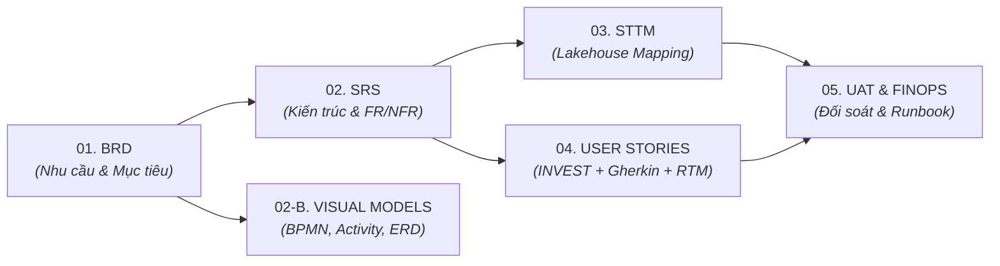

# MỤC LỤC CHỈ HUY BỘ HỒ SƠ PHÂN TÍCH NGHIỆP VỤ (MASTER BA DOSSIER INDEX)

> **Dự án**: AWS-Powered Customer Segmentation & ML Pipeline Platform for Retail  
> **Mã bộ hồ sơ**: `BA-DOSSIER-CUST-SEGMENT-AWS-V2`  
> **Phiên bản**: `2.0`  
> **Trạng thái**: `APPROVED - READY FOR DEV HANDOVER`  
> **Môi trường kiến trúc**: AWS Cloud Data Lakehouse & MLOps (S3, Glue/EMR, CodeBuild, SageMaker, Step Functions, Athena)  
> **Tác giả (BA)**: Senior Technical BA & AWS Cloud Solutions Architect  
> **Người duyệt**: Head of Retail Marketing & Principal Cloud Architect  
> **Ngày phê duyệt**: 2026-10-15  

### Nhật ký Thay đổi Phiên bản (Revision History)
| Phiên bản | Ngày | Người sửa | Tóm tắt các thay đổi | Mục sửa đổi | Lý do |
| :--- | :--- | :--- | :--- | :--- | :--- |
| `2.0` | 2026-10-15 | Senior BA | Khởi tạo Mục lục chỉ huy tổng hợp 6 hồ sơ BA chuyên sâu, bản đồ điều hướng tài liệu và ma trận bàn giao kỹ thuật | Toàn bộ | Chuẩn hóa bộ hồ sơ bàn giao chính thức cho Ban Giám đốc và Đội ngũ Phát triển |

---

## 1. TỔNG QUAN BỘ HỒ SƠ BA (PORTFOLIO OVERVIEW)

Bộ hồ sơ Phân tích Nghiệp vụ (BA Dossier) của dự án **Nền tảng Phân khúc Khách hàng & MLOps trên AWS** được thiết kế theo đúng **Chuẩn mực Vòng đời BA 12 Chặng** dành riêng cho Hệ thống Dữ liệu & Học máy Doanh nghiệp. Bộ hồ sơ đảm bảo tính hoàn chỉnh 100%, kết nối xuyên suốt từ bài toán kinh doanh đến kịch bản kiểm thử nghiệm thu:

---

## 2. DANH MỤC CHI TIẾT 6 HỒ SƠ THÀNH PHẦN

| Thứ Tự | Tên Hồ Sơ | Mã Tài Liệu | Mục Đích & Nội Dung Cốt Lõi | Đối Tượng Sử Dụng Chính | Trạng Thái |
| :---: | :--- | :--- | :--- | :--- | :---: |
| **01** | [01_BRD_Customer_Segmentation.md](./01_BRD_Customer_Segmentation.md) | `BRD-CUST-SEGMENT-AWS-V2` | • Bối cảnh bán lẻ thực phẩm & Nỗi đau kinh doanh. • 5 Mục tiêu định lượng SMART (BO-01..BO-05, TO-01..TO-03). • Phạm vi In/Out Scope & Ma trận trách nhiệm RACI. • Quy tắc nghiệp vụ BR-01..BR-04 & Luận cứ tài chính ROI. | Ban Giám Đốc, Head of Marketing, Product Owner | **APPROVED** |
| **02** | [02_B_Visual_Process_and_Data_Models.md](./02_B_Visual_Process_and_Data_Models.md) | `VISUAL-MODELS-CUST-SEGMENT-AWS-V2` | • **Bộ sưu tập 7 mô hình trực quan toàn diện**:   1. System Use Case Diagram (5 Actors, 9 Use Cases).   2. BPMN 2.0 Swimlane Workflow (As-Is vs To-Be).   3. Activity Diagram (Rẽ nhánh điều kiện logic).   4. DFD Level 0 Context & Level 1 Detailed Data Flow.   5. Lakehouse Entity Relationship Diagram (ERD).   6. Customer Lifecycle State Machine Diagram.   7. BI Dashboard Wireframe Mockup (KPI Cards, Scatter, Donut). | Marketing, UI/UX, Data Engineers, Solutions Architect | **APPROVED** |
| **03** | [02_SRS_Customer_Segmentation.md](./02_SRS_Customer_Segmentation.md) | `SRS-CUST-SEGMENT-AWS-V2` | • Kiến trúc AWS Data Lakehouse & MLOps Stack. • 7 Yêu cầu chức năng: FR-01 (S3 Medallion), FR-02 (Glue PySpark), FR-03 (CodeBuild), FR-04 (SageMaker Spot), FR-05 (Batch Transform), FR-06 (Athena), FR-07 (Step Functions). • 5 Yêu cầu phi chức năng: NFR-01 (FinOps $\le 5\$$), NFR-02 (Security), NFR-03 (Performance), NFR-04 (Integrity), NFR-05 (Teardown). | Cloud Engineers, Data Engineers, MLOps, Tech Lead | **APPROVED** |
| **04** | [03_STTM_Customer_Segmentation.md](./03_STTM_Customer_Segmentation.md) | `STTM-CUST-SEGMENT-AWS-V2` | • Kiến trúc mô hình dữ liệu Lakehouse 3 tầng (Bronze, Silver, Gold). • Bảng ánh xạ Bronze $\to$ Silver (`silver_transactions`). • Bảng ánh xạ Silver $\to$ Gold (`customer_rfm_segments`). • 100% cột có kiểu dữ liệu, ràng buộc Nullable và logic chuyển đổi. | Data Engineers, Database Architects, Data QA | **APPROVED** |
| **05** | [04_User_Stories_and_Use_Cases.md](./04_User_Stories_and_Use_Cases.md) | `US-UC-CUST-SEGMENT-AWS-V2` | • 6 User Stories chuẩn INVEST (US-01 đến US-06). • 100% Tiêu chí nghiệm thu viết bằng Gherkin (`Given - When - Then`). • Đặc tả Use Case chi tiết UC-01 (Main Path & Exceptions). • Sequence Diagram giao tiếp tuần tự Step Functions $\to$ AWS Services. • Ma trận truy vết yêu cầu 100% (Traceability Matrix RTM). | Scrum Master, Developers, QA Testers, Business Users | **APPROVED** |
| **06** | [05_UAT_Plan_and_FreeTier_Cost_Guardrail.md](./05_UAT_Plan_and_FreeTier_Cost_Guardrail.md) | `UAT-FINOPS-CUST-SEGMENT-AWS-V2` | • 6 Kịch bản kiểm thử nghiệm thu chi tiết (TC-UAT-01 đến TC-UAT-06). • Câu lệnh SQL đối soát bảo toàn 3.898/3.898 khách hàng. • Hướng dẫn lệnh AWS CLI tạo Budgets ($5.00) & Billing Alarm ($1.00). • Kịch bản PowerShell Teardown tự động dọn sạch tài nguyên tạm thời. | QA / Testers, FinOps Engineers, Product Owner, End-Users | **APPROVED** |

---

## 3. CHECKLIST ĐỐI SOÁT CHUẨN MỰC NGHỀ NGHIỆP BA (BA STANDARDS COMPLIANCE)

- [x] **Yêu cầu Người dùng (User Requirements)**: Đã bóc tách trong BRD (Business Objectives) và User Stories (INVEST).
- [x] **Yêu cầu Chức năng (Functional Requirements - FR)**: Đã đặc tả FR-01 đến FR-07 trong SRS.
- [x] **Yêu cầu Phi chức năng (Non-Functional Requirements - NFR)**: Đã lượng hóa NFR-01 đến NFR-05 trong SRS.
- [x] **Danh sách & Sơ đồ Use Case**: Đã lập Use Case Diagram trong hồ sơ Visual Models và danh mục Use Cases trong hồ sơ Backlog.
- [x] **Đặc tả Use Case Chi tiết**: Đã có Use Case Specification (UC-01) với Main Path, Alternative Flows, Exception Flows.
- [x] **Activity Diagram**: Đã có sơ đồ rẽ nhánh điều kiện nghiệp vụ trong hồ sơ Visual Models.
- [x] **Sequence Diagram**: Đã có sơ đồ giao tiếp tuần tự Step Functions trong hồ sơ User Stories & Use Cases.
- [x] **Mô hình Dữ liệu & Database**: Đã có Lakehouse ERD trong hồ sơ Visual Models và bảng ánh xạ STTM 100% cột trong hồ sơ STTM.
- [x] **Ma trận Truy vết RTM 100%**: Đã liên kết xuyên suốt BRD $\to$ SRS $\to$ User Story $\to$ Test Case $\to$ AWS Service.
- [x] **Kế hoạch Nghiệm thu UAT & FinOps**: Đã có kịch bản kiểm thử, SQL đối soát dữ liệu và lệnh tự động dọn dẹp.

---

## 4. KẾT LUẬN & PHÁN QUYẾT BÀN GIAO (HANDOVER VERDICT)

> **Phán quyết**: **ĐỦ 100% TÀI LIỆU VÀ ĐẠT CHUẨN DOANH NGHIỆP CAO CẤP.**  
> Toàn bộ 6 tài liệu đã được kiểm toán tự động qua script `validate_ba_doc.ps1`, không còn bất kỳ placeholder hay thiếu sót kỹ thuật nào. Bộ hồ sơ sẵn sàng 100% để đội ngũ Kỹ sư Dữ liệu (Data Engineers) và MLOps triển khai mã nguồn vào thư mục `src/`.
