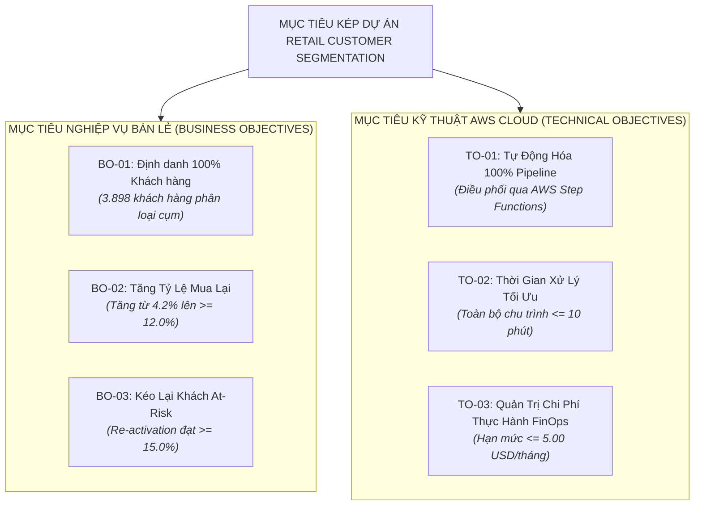

# BRD - TÀI LIỆU YÊU CẦU NGHIỆP VỤ: NỀN TẢNG AWS DATA & MACHINE LEARNING PHÂN KHÚC KHÁCH HÀNG (AWS-POWERED ENTERPRISE CUSTOMER SEGMENTATION PLATFORM)

> **Dự án**: AWS-Powered Customer Segmentation & ML Pipeline Platform for Retail  
> **Mã hồ sơ**: `BRD-CUST-SEGMENT-AWS-V2`  
> **Phiên bản**: `2.0`  
> **Trạng thái**: `APPROVED`  
> **Môi trường hạ tầng**: AWS Cloud Data & MLOps Platform (S3, Glue/EMR, SageMaker, CodeBuild, Step Functions, Athena)  
> **Tác giả (BA)**: Senior Technical BA & AWS Cloud Solutions Architect  
> **Người phê duyệt (Business & Tech Sponsor)**: Head of Data Engineering & Retail Marketing Director  
> **Ngày phê duyệt**: 2026-10-15  

### Nhật ký Thay đổi Phiên bản (Revision History)
| Phiên bản | Ngày | Người sửa | Tóm tắt các thay đổi | Mục sửa đổi | Lý do |
| :--- | :--- | :--- | :--- | :--- | :--- |
| `1.0` | 2026-10-15 | Senior BA | Khởi tạo tài liệu BRD phân khúc khách hàng bán lẻ trên AWS Free Tier | Toàn bộ | Phiên bản baseline ban đầu |
| `2.0` | 2026-10-15 | Senior BA & Cloud Architect | Nâng cấp toàn diện sang dự án học thực hành & xây dựng kiến trúc AWS chuẩn doanh nghiệp (S3 Medallion, Glue/EMR Spark, CodeBuild CI/CD, SageMaker MLOps, Step Functions, Athena) kèm chiến lược Ephemeral Cost Governance | Toàn bộ | Chuyển đổi định hướng dự án sang End-to-End AWS Build Project phục vụ thực hành kỹ sư dữ liệu và triển khai thực tế |

---

## 1. TỔNG QUAN DỰ ÁN (EXECUTIVE SUMMARY)

### 1.1 Bối cảnh Doanh nghiệp & Định hướng Dự án
Cửa hàng bán lẻ thực phẩm X vận hành mạng lưới bán lẻ hàng hóa thiết yếu B2C với hàng chục nghìn giao dịch mỗi tháng. Trong bối cảnh chuyển đổi số và nâng cao năng lực cạnh tranh, doanh nghiệp quyết định xây dựng **Nền tảng Phân khúc Khách hàng & MLOps Tự động hóa trên AWS Cloud (AWS-Powered Customer Segmentation Platform)**.

Dự án vừa phục vụ trực tiếp nghiệp vụ bán lẻ thực tế, vừa đóng vai trò là **Dự án Chuẩn mực Thực hành Kỹ thuật Đám mây (AWS Hands-on Build Project)** theo tiêu chuẩn AWS Data Engineer (DEA-C01) và AWS Solutions Architect (SAA-C03), áp dụng các dịch vụ cốt lõi:
- **Lưu trữ & Hồ dữ liệu (Data Lake)**: Amazon S3 theo kiến trúc Medallion (Bronze / Silver / Gold).
- **Xử lý Dữ liệu Lớn (Big Data ETL)**: AWS Glue / Amazon EMR (PySpark) để chuẩn hóa và tổng hợp đặc trưng RFM.
- **Đóng gói & CI/CD**: AWS CodeBuild tự động build container Docker và deploy pipeline.
- **Học máy & MLOps**: Amazon SageMaker (Training Job với Managed Spot Instances, S3 Model Registry, Batch Transform).
- **Điều phối Luồng (Orchestration)**: AWS Step Functions & Amazon EventBridge.
- **Phục vụ Phân tích & Báo cáo (Serving & BI)**: Amazon Athena (Serverless SQL) và xuất bản sang Amazon QuickSight.

### 1.2 Tuyên ngôn Bài toán (Problem Statement)
- **Về mặt Nghiệp vụ Bán lẻ**:
  * Doanh nghiệp tiếp thị đại trà (Mass Marketing) không phân loại khách hàng, tỷ lệ mở email/SMS khuyến mãi $< 4.5\%$.
  * Tỷ lệ khách hàng rời bỏ ngầm sau 60 ngày không mua hàng tăng 6.8%/năm, gây thất thoát khoảng 450 triệu VND doanh thu/năm.
  * Chưa định lượng được giá trị đóng góp của nhóm khách hàng VIP (Champions) để có chính sách giữ chân xứng tầm.
- **Về mặt Kỹ thuật & Hạ tầng Dữ liệu**:
  * Dữ liệu giao dịch nằm phân tán ở dạng file CSV thô, chưa có Data Lakehouse tập trung và chưa được đánh chỉ mục.
  * Quy trình phân cụm khách hàng trước đây chạy thủ công trên máy trạm cá nhân, không có khả năng mở rộng khi khối lượng giao dịch tăng gấp 10-100 lần.
  * Thiếu quy trình MLOps tự động hóa từ trích xuất đặc trưng $\to$ huấn luyện mô hình $\to$ suy luận phân khúc $\to$ cập nhật báo cáo.

---

## 2. MỤC TIÊU DỰ ÁN ĐỊNH LƯỢNG (PROJECT OBJECTIVES)

Dự án thiết lập 2 nhóm mục tiêu song hành: Mục tiêu Nghiệp vụ Bán lẻ và Mục tiêu Kỹ thuật AWS Cloud:

| Mã Mục Tiêu | Phân Loại | Mục Tiêu Cụ Thể | Chỉ Số Đo Lường (KPI Metric) | Hiện Trạng (Baseline) | Mục Tiêu Đạt Được (Target) |
| :---: | :--- | :--- | :--- | :---: | :---: |
| **BO-01** | Nghiệp vụ | Tự động hóa định danh phân khúc khách hàng | Tỷ lệ khách hàng có phát sinh giao dịch được phân cụm | 0% (Thủ công) | 100% (3.898+ khách hàng) |
| **BO-02** | Nghiệp vụ | Nâng cao hiệu quả chiến dịch tiếp thị cá nhân hóa | Tỷ lệ chuyển đổi mua lại từ chiến dịch tiếp thị | 4.2% | $\ge 12.0\%$ sau 3 tháng |
| **BO-03** | Nghiệp vụ | Giữ chân và kích hoạt lại nhóm khách hàng At-Risk | Tỷ lệ phản hồi chiến dịch kích hoạt lại (Re-activation) | 3.0% | $\ge 15.0\%$ sau 3 tháng |
| **TO-01** | Kỹ thuật AWS | Tự động hóa Pipeline từ Ingestion đến Serving | Tỷ lệ tự động hóa qua AWS Step Functions | 0% | 100% không cần can thiệp thủ công |
| **TO-02** | Kỹ thuật AWS | Tối ưu hóa thời gian huấn luyện & suy luận ML | Thời gian thực thi toàn bộ SageMaker Pipeline | N/A | $\le 10$ phút / batch run |
| **TO-03** | Kỹ thuật AWS | **Quản trị Ngân sách Thực hành Đám mây (Cost Governance)** | Chi phí vận hành hạ tầng AWS hàng tháng cho Lab/Thực hành | N/A | **$\le 5.00$ USD / tháng** (nhờ cơ chế Ephemeral & Spot) |

---

## 3. PHẠM VI DỰ ÁN (PROJECT SCOPE)

### 3.1 Phạm vi Triển khai (In-Scope)
1. **Thiết kế Hồ Dữ liệu Amazon S3 Medallion**:
   - `s3://customer-segmentation-bronze/`: Lưu trữ dữ liệu giao dịch thô (`Transactions.csv`, `Products_with_Categories.csv`).
   - `s3://customer-segmentation-silver/`: Dữ liệu đã được làm sạch, ép kiểu và làm giàu (Enriched transactions) định dạng Parquet.
   - `s3://customer-segmentation-gold/`: Bảng đặc trưng RFM (`customer_rfm_features`) và kết quả phân cụm (`customer_segmented_results`).
2. **Kỹ thuật Xử lý Dữ liệu Lớn với AWS Glue / EMR Spark**:
   - Viết PySpark script làm sạch dữ liệu, xử lý missing prices, tính toán chỉ số RFM (Recency, Frequency, Monetary) per `Member_number`.
   - Lưu trữ và lập danh mục bảng siêu dữ liệu trên **AWS Glue Data Catalog**.
3. **Đóng gói Quy trình & Tích hợp Liên tục với AWS CodeBuild**:
   - Viết `buildspec.yml` đóng gói mã nguồn ETL và thuật toán ML vào Docker Container.
   - Tự động đẩy container image lên **Amazon ECR** để SageMaker kéo về huấn luyện.
4. **Xây dựng MLOps Pipeline trên Amazon SageMaker**:
   - Huấn luyện mô hình K-Means Clustering tối ưu hóa số cụm ($K=5$) dựa trên Silhouette Score.
   - Vận dụng **SageMaker Managed Spot Training** (tiết kiệm đến 70-90% chi phí điện toán EC2).
   - Xuất model artifact (`model.tar.gz`) lưu trữ an toàn trên S3.
   - Thực thi **SageMaker Batch Transform** để gán nhãn phân khúc cho toàn bộ tập khách hàng định kỳ (không duy trì Real-time Endpoint chạy 24/7 để tránh tốn tiền ngầm).
5. **Điều phối Tự động hóa với AWS Step Functions**:
   - Xây dựng State Machine điều phối tuần tự: `Trigger S3` $\to$ `Glue ETL Job` $\to$ `SageMaker Training/Transform` $\to$ `Glue Catalog Crawler` $\to$ `SNS Notification`.
6. **Phục vụ Truy vấn & Báo cáo với Amazon Athena & QuickSight**:
   - Cung cấp giao diện Serverless SQL để phòng Marketing truy vấn trực tiếp danh sách khách hàng VIP, At-Risk.
7. **Hệ thống Giám sát & Chốt chặn Ngân sách (Cloud Cost & Security Guardrails)**:
   - Cấu hình **AWS Budgets** với hạn mức cảnh báo 5.00 USD.
   - Thiết lập **CloudWatch Billing Alarm** báo động khi chi phí vượt quá 1.00 USD.
   - Cung cấp kịch bản **Teardown & Cleanup Automation** giải phóng tài nguyên sau mỗi phiên thực hành.

### 3.2 Phạm vi Không Triển khai (Out-of-Scope)
- **CẤM DUY TRÌ TÀI NGUYÊN 24/7**: Không duy trì Amazon SageMaker Real-time Endpoint chạy liên tục (dùng Batch Transform chạy theo yêu cầu).
- **CẤM KHỞI TẠO CÁC DỊCH VỤ IDLE TỐN PHÍ NỀN**: Không tạo NAT Gateway trong VPC cá nhân; không tạo RDS Multi-AZ hay Redshift Provisioned Cluster khi Athena đã đáp ứng hoàn hảo nhu cầu truy vấn.
- **KHÔNG THAY THẾ HỆ THỐNG POS/ERP GỐC**: Nền tảng tiếp nhận dữ liệu kết xuất từ hệ thống hiện hữu, không can thiệp vào mã nguồn phần mềm thu ngân.

---

## 4. MA TRẬN TRÁCH NHIỆM RACI (RACI MATRIX)

| Bên Liên Quan | Vai Trò | Nhiệm Vụ Cụ Thể | R | A | C | I |
| :--- | :--- | :--- | :---: | :---: | :---: | :---: |
| Giám đốc Chuỗi Bán Lẻ | Business Sponsor | Phê duyệt mục tiêu kinh doanh và ngân sách thực hành đám mây | | X | | |
| Trưởng phòng Marketing | Product Owner | Định nghĩa tiêu chí 5 phân khúc và chiến dịch tiếp thị tương ứng | X | | | |
| Senior Technical BA | Cố vấn & Đặc tả | Lập BRD, SRS, STTM, kịch bản UAT và giám sát kiến trúc AWS | X | | | |
| Data / Cloud Engineer | Kỹ sư Dữ liệu & AWS | Thiết lập S3, Glue/EMR PySpark, CodeBuild, Step Functions, Athena | X | | | |
| MLOps / ML Engineer | Kỹ sư Học máy | Xây dựng thuật toán K-Means trên SageMaker, tối ưu Spot Training | X | | | |
| Quản lý Hạ tầng & Bảo mật | Cloud Security & FinOps | Cấu hình IAM Least Privilege, AWS Budgets, CloudWatch Alarms | | | X | |
| Đội ngũ Chăm sóc Khách hàng | Người dùng Cuối | Khai thác kết quả phân khúc từ Athena/QuickSight để thực thi chiến dịch | | | | X |

---

## 5. QUY TẮC NGHIỆP VỤ & TÍNH TOÁN CỐT LÕI (CORE BUSINESS RULES)

- **BR-01 (Mốc Tính Recency Chuẩn Hóa)**:
  $$\text{Recency}_i = \max(\text{Date}_{\text{dataset}}) - \max(\text{Date}_i)$$
  Đo lường số ngày kể từ lần giao dịch gần nhất của khách hàng $i$ đến mốc thời gian chốt sổ mới nhất trong toàn bộ cơ sở dữ liệu.
- **BR-02 (Quy Tắc Tính Tổng Chi Tiêu Monetary)**:
  $$\text{Monetary}_i = \sum_{j \in \text{Transactions}_i} (\text{Quantity}_j \times \text{Price}_j)$$
  Nếu bản ghi thiếu giá sản phẩm, hệ thống áp dụng giá trung vị (Median Price) của nhóm ngành hàng (`Category`) tương ứng trong bảng sản phẩm.
- **BR-03 (Phân Định 5 Nhóm Khách Hàng Nghiệp Vụ)**:
  1. 👑 **Champions (Khách Hàng Tinh Anh)**: $R \ge 4, F \ge 4, M \ge 4 \to$ Đặc quyền VIP, quà tặng sinh nhật cá nhân hóa.
  2. 💎 **Loyal Customers (Khách Hàng Thân Thiết)**: $R \ge 3, F \ge 3, M \ge 3 \to$ Chương trình tích lũy điểm thưởng, ưu đãi combo gia đình.
  3. 🌱 **Promising / New Customers (Khách Hàng Tiềm Năng)**: $R \ge 4, F \le 2, M \le 2 \to$ Mã giảm giá kích cầu cho đơn hàng kế tiếp trong 7 ngày.
  4. ⚠️ **At Risk (Khách Hàng Có Nguy Cơ Rời Bỏ)**: $R \le 2, F \ge 3, M \ge 3 \to$ Gửi khảo sát chất lượng kèm voucher ưu đãi đặc biệt để kéo lại.
  5. ❄️ **Lost / Hibernating (Khách Hàng Ngủ Đông)**: $R \le 1, F \le 1, M \le 1 \to$ Chiến dịch tái kích hoạt qua kênh chi phí thấp (Email marketing định kỳ).
- **BR-04 (Nguyên Tắc Quản Trị Chi Phí AWS Ephemeral)**:
  Mọi tài nguyên tính toán (Compute) trên AWS (SageMaker Training Instances, CodeBuild, Glue Jobs, EMR Nodes) phải vận hành theo mô hình **Tự Khởi Tạo - Tự Chấm Dứt (Ephemeral)**: Chỉ kích hoạt khi có lệnh xử lý, tự động giải phóng toàn bộ tài nguyên (Delete on Termination) sau khi hoàn tất công việc.

---

## 6. PHÂN TÍCH HIỆU QUẢ KINH TẾ & QUẢN TRỊ TÀI CHÍNH ĐÁM MÂY (COST-BENEFIT & FINOPS)

### 6.1 Lợi Ích Kinh Tế Doanh Nghiệp (Business Returns)
- **Gia tăng Doanh thu Bán lẻ**: Ước tính tăng trưởng **180 - 250 triệu VND / năm** nhờ chuyển đổi tiếp thị đúng khách hàng VIP và bán chéo (cross-sell) theo ngành hàng.
- **Cắt giảm Chi phí Tiếp thị Phí phạm**: Tiết kiệm **40 - 55 triệu VND / năm** ngân sách gửi tin nhắn SMS Brandname/Zalo nhờ loại bỏ khách hàng ngủ đông không có tiềm năng chuyển đổi.

### 6.2 Mô Hình Chi Phí Hạ Tầng AWS Thực Hành (Hands-on FinOps Architecture)
Dự án được thiết kế để vừa thực hành đầy đủ các dịch vụ AWS doanh nghiệp, vừa tối ưu hóa chi phí thực nghiệm ở mức tối thiểu:

| Dịch Vụ AWS | Cơ Chế Tính Phí Thực Hành | Hạn Mức Miễn Phí / Tối Ưu | Chi Phí Ước Tính Cho Mỗi Lần Run |
| :--- | :--- | :--- | :---: |
| **Amazon S3** | Standard Storage & Requests | 5 GB Free Tier vĩnh viễn (dataset dự án $< 50$ MB) | **0.00 USD** |
| **AWS CodeBuild** | Build Docker Container | 100 phút build `general1.small` miễn phí/tháng | **0.00 USD** |
| **Amazon Athena** | Serverless SQL Query | 1 TB dữ liệu quét/tháng miễn phí (mỗi query chỉ quét vài MB) | **0.00 USD** |
| **AWS Step Functions**| State Machine Orchestration | 4.000 lượt chuyển đổi trạng thái miễn phí/tháng | **0.00 USD** |
| **AWS Glue / EMR** | PySpark ETL Data Processing | Dùng AWS Glue 1 DPU chạy $\sim 2-3$ phút hoặc Local Spark | $\sim 0.02 - 0.04$ USD / run |
| **Amazon SageMaker** | K-Means Training & Batch Transform | Managed Spot Training `ml.m5.large` chạy $\sim 3$ phút | $\sim 0.01 - 0.03$ USD / run |
| **Amazon CloudWatch** | Logs, Metrics & Billing Alarms | 10 Alarms & 5 GB Log ingestion miễn phí | **0.00 USD** |
| **TỔNG CHI PHÍ THỰC HÀNH DỰ KIẾN** | **Toàn bộ chu trình End-to-End** | **Tối ưu triệt để theo mô hình Ephemeral** | **$< 0.10$ USD / lần chạy full** |
