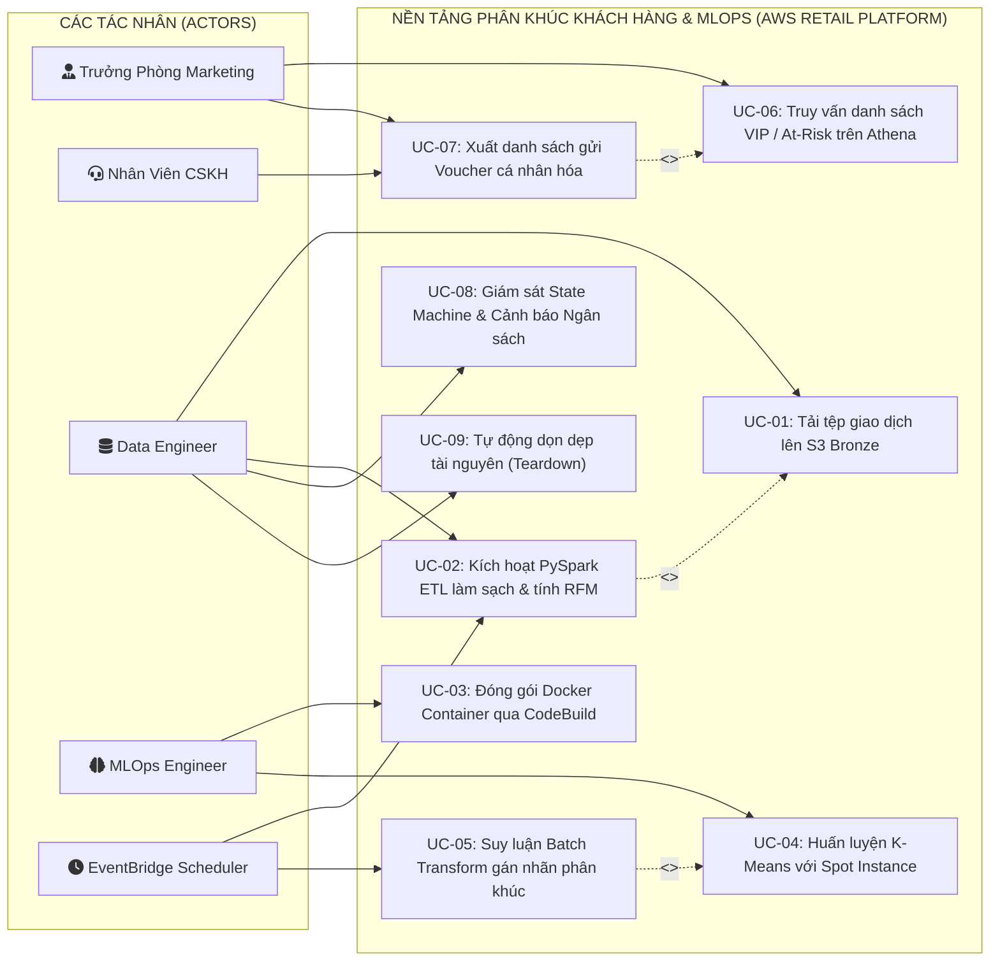
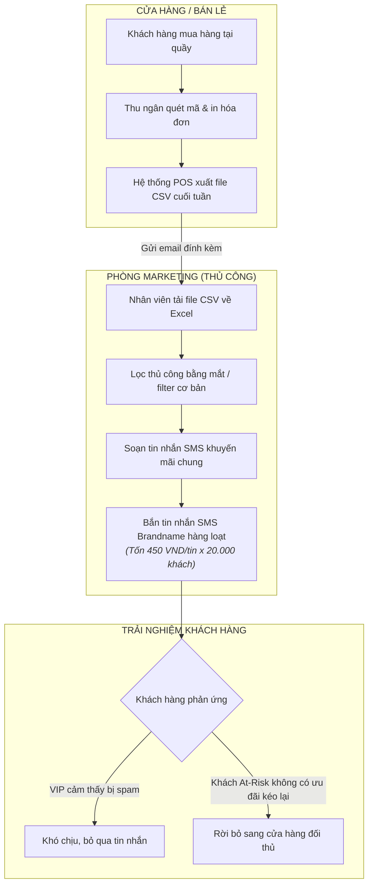
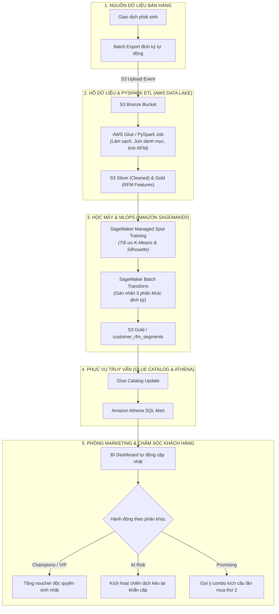
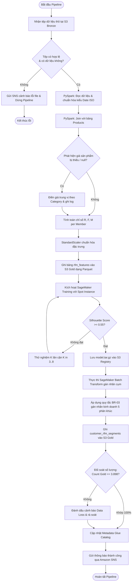
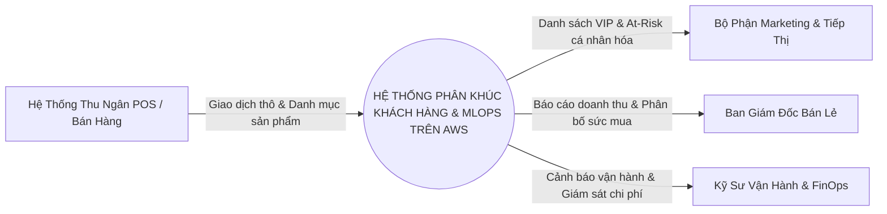
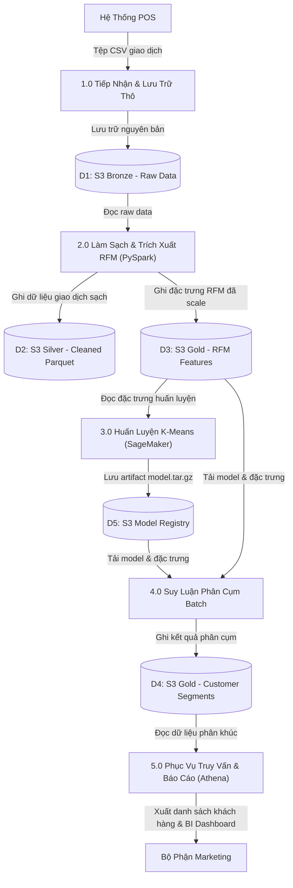
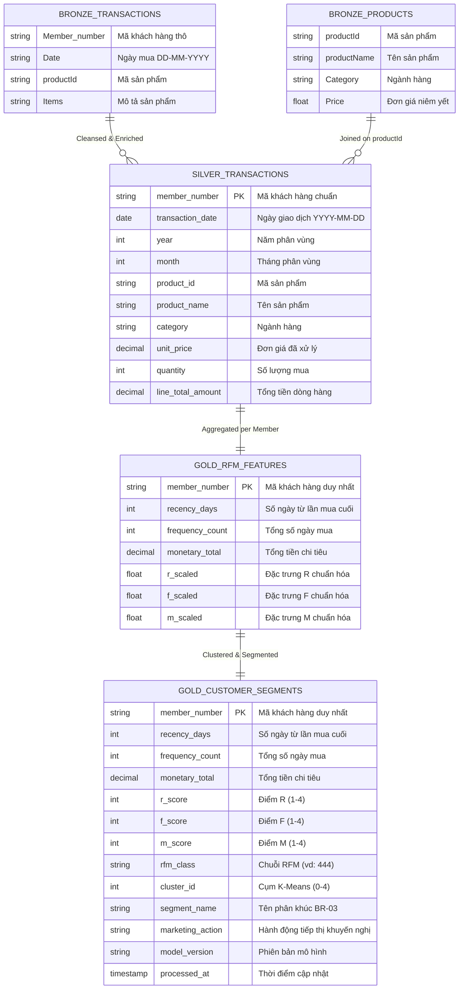
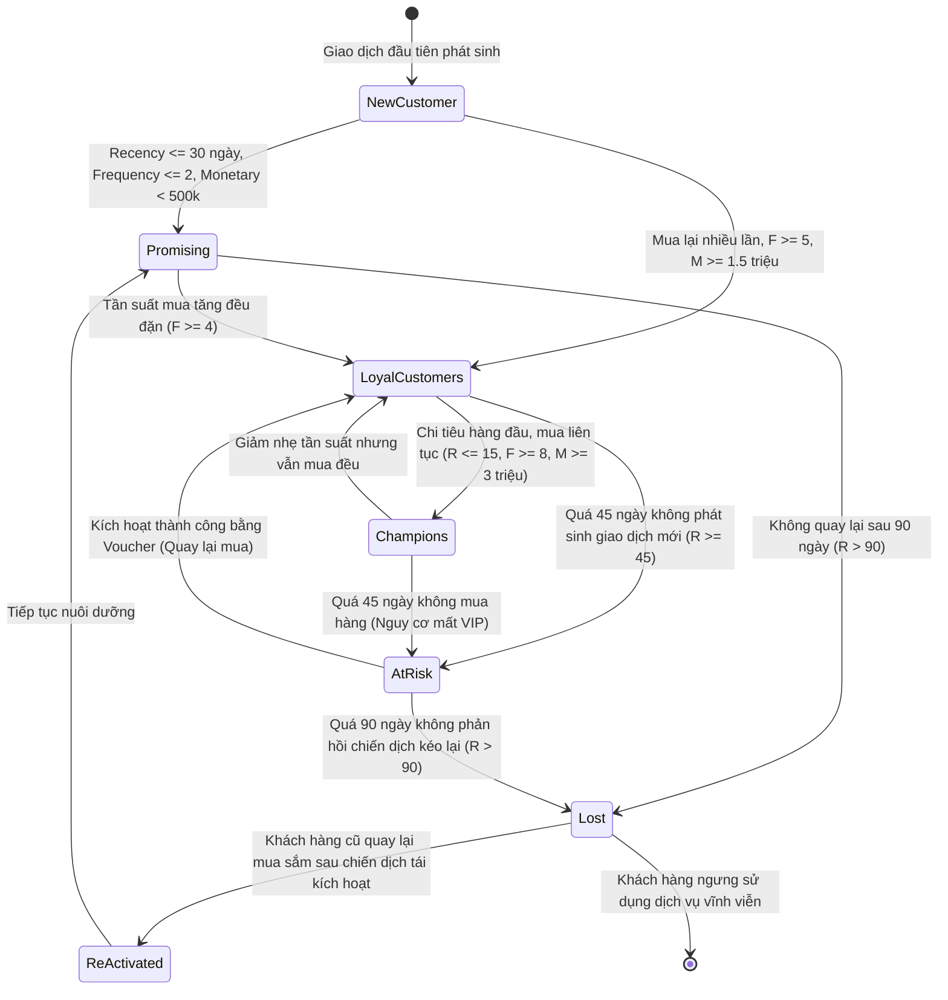
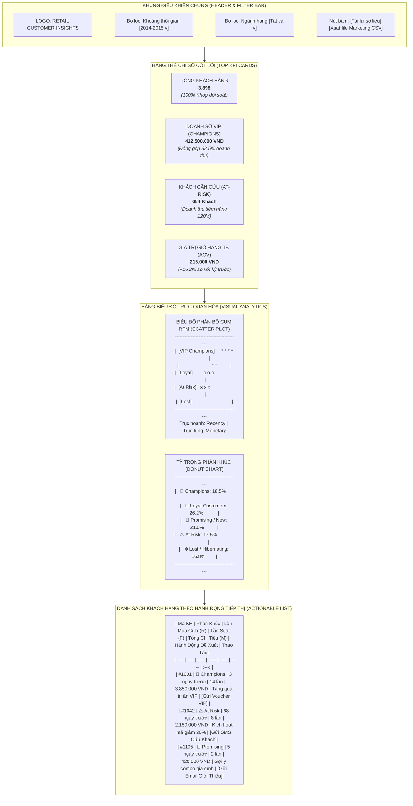

# BẢN ĐẶC TẢ MÔ HÌNH HÓA TRỰC QUAN NGHIỆP VỤ & DÒNG CHẢY DỮ LIỆU (VISUAL BUSINESS PROCESS & DATA MODELS)

> **Dự án**: AWS-Powered Customer Segmentation & ML Pipeline Platform for Retail  
> **Mã hồ sơ**: `VISUAL-MODELS-CUST-SEGMENT-AWS-V2`  
> **Phiên bản**: `2.0`  
> **Trạng thái**: `APPROVED`  
> **Tham chiếu BRD/SRS**: `BRD-CUST-SEGMENT-AWS-V2`, `SRS-CUST-SEGMENT-AWS-V2`  
> **Tác giả (BA)**: Senior Technical BA & Visual Process Architect  
> **Người duyệt**: Head of Retail Marketing & Cloud Tech Lead  
> **Ngày phê duyệt**: 2026-10-15  

### Nhật ký Thay đổi Phiên bản (Revision History)
| Phiên bản | Ngày | Người sửa | Tóm tắt các thay đổi | Mục sửa đổi | Lý do |
| :--- | :--- | :--- | :--- | :--- | :--- |
| `2.0` | 2026-10-15 | Senior BA | Khởi tạo đầy đủ 7 mô hình trực quan chuẩn mực: Use Case Diagram, BPMN As-Is vs To-Be Swimlane, Activity Diagram, DFD Level 0 & 1, Lakehouse ERD, Customer Lifecycle State Machine, và BI Dashboard Wireframe Mockup | Toàn bộ | Chuẩn hóa bộ hồ sơ trực quan hóa toàn diện phục vụ Stakeholder và Dev Team |

---

## 1. SƠ ĐỒ USE CASE TỔNG THỂ (SYSTEM USE CASE DIAGRAM)

Sơ đồ thể hiện toàn bộ các tác nhân (Actors) và mối quan hệ tương tác với các phân hệ chức năng trên nền tảng AWS:

---

## 2. QUY TRÌNH NGHIỆP VỤ BPMN 2.0 PHÂN LÀN (SWIMLANE WORKFLOW: AS-IS VS TO-BE)

### 2.1 Quy Trình Hiện Trạng (As-Is: Thủ Công, Chậm Trễ & Thất Thoát)
Hiện tại, dữ liệu nằm rời rạc trong các file Excel/CSV máy cá nhân. Tiếp thị dàn trải gửi cùng một thông điệp cho toàn bộ khách hàng:

### 2.2 Quy Trình Tương Lai (To-Be: Tự Động Hóa 100% trên AWS Cloud Data Lakehouse)

---

## 3. SƠ ĐỒ HOẠT ĐỘNG CHI TIẾT (ACTIVITY DIAGRAM VỚI CÁC ĐIỀU KIỆN RẼ NHÁNH)

Sơ đồ mô tả chi tiết logic điều kiện, kiểm tra lỗi và rẽ nhánh từ lúc dữ liệu thô vào đến khi xuất báo cáo:

---

## 4. SƠ ĐỒ DÒNG CHẢY DỮ LIỆU (DATA FLOW DIAGRAM - DFD LEVEL 0 & LEVEL 1)

### 4.1 DFD Level 0 (Context Diagram - Bối Cảnh Hệ Thống)

### 4.2 DFD Level 1 (Phân Rã Tiến Trình Xử Lý & Kho Dữ Liệu)

---

## 5. MÔ HÌNH DỮ LIỆU QUAN HỆ & THỰC THỂ LAKEHOUSE (ERD)

Sơ đồ mô tả cấu trúc quan hệ giữa các bảng từ tầng Bronze qua Silver đến Gold:

---

## 6. SƠ ĐỒ MÁY TRẠNG THÁI VÒNG ĐỜI KHÁCH HÀNG (CUSTOMER LIFECYCLE STATE MACHINE)

Sơ đồ mô tả quy luật biến chuyển giữa các trạng thái khách hàng theo thời gian và hành vi chi tiêu:

---

## 7. BẢN VẼ BỐ CỤC GIAO DIỆN BẢNG ĐIỀU KHIỂN (BI DASHBOARD WIREFRAME MOCKUP)

Bản vẽ thiết kế khung nhìn trực quan (Wireframe Mockup) cho Bảng điều khiển Phân khúc Khách hàng phục vụ Giám đốc Bán lẻ và Trưởng phòng Marketing:

