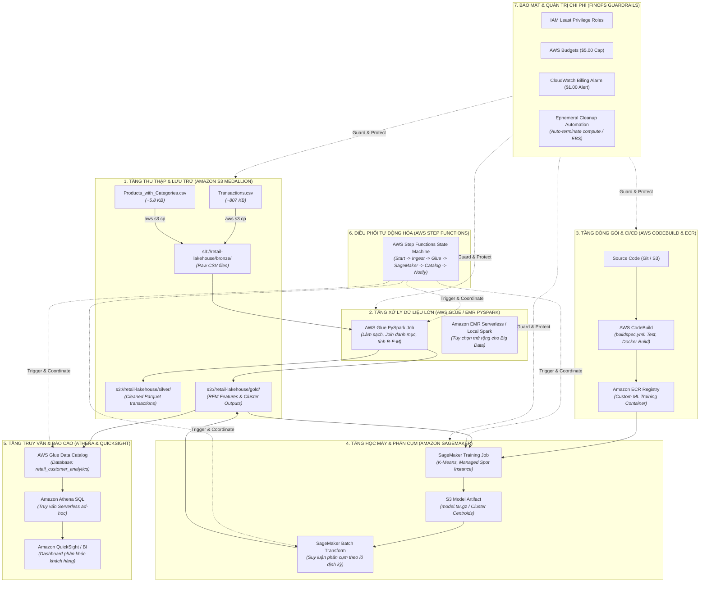

# SRS - ĐẶC TẢ KỸ THUẬT & KIẾN TRÚC AWS DATA & ML PLATFORM (END-TO-END AWS PIPELINE: S3, GLUE/EMR, CODEBUILD, SAGEMAKER, STEP FUNCTIONS, ATHENA)

> **Dự án**: AWS-Powered Customer Segmentation & ML Pipeline Platform for Retail  
> **Mã hồ sơ**: `SRS-CUST-SEGMENT-AWS-V2`  
> **Phiên bản**: `2.0`  
> **Trạng thái**: `APPROVED`  
> **Tham chiếu BRD**: `BRD-CUST-SEGMENT-AWS-V2`  
> **Tác giả (BA)**: Senior Technical BA & AWS Cloud Solutions Architect  
> **Người phê duyệt (Tech Lead)**: Principal Cloud Architect & Lead MLOps Engineer  
> **Ngày phê duyệt**: 2026-10-15  

### Nhật ký Thay đổi Phiên bản (Revision History)
| Phiên bản | Ngày | Người sửa | Tóm tắt các thay đổi | Mục sửa đổi | Lý do |
| :--- | :--- | :--- | :--- | :--- | :--- |
| `1.0` | 2026-10-15 | Senior BA | Đặc tả hệ thống serverless S3/Athena mức Free Tier | Toàn bộ | Phiên bản baseline ban đầu |
| `2.0` | 2026-10-15 | Senior BA & Cloud Architect | Mở rộng toàn diện thành kiến trúc Enterprise AWS Data & ML Stack: S3 Medallion, Glue/EMR PySpark, CodeBuild CI/CD, SageMaker Spot Training/Batch Transform, Step Functions State Machine và Ephemeral FinOps Guardrail | Toàn bộ | Chuẩn hóa kiến trúc dữ liệu và MLOps cấp doanh nghiệp |

---

## 1. TỔNG QUAN KIẾN TRÚC HỆ THỐNG AWS (ENTERPRISE AWS ARCHITECTURE)

Hệ thống được thiết kế theo chuẩn kiến trúc Hồ Dữ liệu hiện đại (**Modern Data Lakehouse & MLOps Architecture**) trên AWS, tích hợp liền mạch giữa kỹ thuật dữ liệu (Data Engineering) và học máy (Machine Learning):



---

## 2. QUY CHUẨN TÀI NGUYÊN & ĐIỀU KHOẢN QUẢN TRỊ CHI PHÍ EPHEMERAL (FINOPS RULES)

Để đảm bảo kiến trúc vận hành tối ưu với chi phí tối thiểu theo chuẩn Lean FinOps ($\le 5.00$ USD/tháng):

| Dịch Vụ AWS | Cấu Hình Khuyến Nghị Cho Dự Án | Thời Gian Vận Hành Dự Kiến | Cơ Chế Tiết Kiệm Chi Phí (Cost Optimization) |
| :--- | :--- | :--- | :--- |
| **Amazon S3** | Standard Storage | Lưu trữ liên tục | Dung lượng $< 50$ MB $\to$ Nằm hoàn toàn trong 5 GB Free Tier vĩnh viễn. |
| **AWS Glue** | Glue 4.0 (Spark 3.3, Python 3.10), Worker: `G.1X`, Số worker: 2 | 2 - 3 phút / lần chạy | Tính tiền đúng 3 phút ($\approx 0.04$ USD). Tự động tắt sau khi hoàn thành. |
| **AWS CodeBuild** | Environment: `aws/codebuild/standard:7.0`, Compute: `BUILD_GENERAL1_SMALL` | 3 - 5 phút / lần build | Sử dụng 100 phút build miễn phí hàng tháng của AWS Free Tier. |
| **Amazon SageMaker**| Training: `ml.m5.large`, Spot Instance (`use_spot_instances=True`) | 2 - 4 phút / job | Giảm giá 70% so với On-Demand. Dùng Batch Transform thay cho Real-time Endpoint để tránh tốn tiền treo máy 24/7. |
| **Amazon EBS** | GP3 volume đi kèm SageMaker/ECR | Tồn tại theo vòng đời Job | Bật cờ `DeleteOnTermination=true` để tự động hủy volume khi job kết thúc. |
| **Amazon Athena** | Engine Version 3, Định dạng bảng Parquet nén Snappy | Khi có câu lệnh SQL | Chỉ quét các cột cần thiết, tận dụng 1 TB quét miễn phí/tháng. |
| **AWS Step Functions**| Standard State Machine | $< 10$ trạng thái / lần chạy | Tận dụng 4.000 lượt chuyển đổi trạng thái miễn phí mỗi tháng. |

### 🚫 CÁC NGUYÊN TẮC BẢO VỆ CHI PHÍ BẤT DI BẤT DỊCH (INVIOLABLE FINOPS LAWS):
1. **Tuyệt đối KHÔNG triển khai SageMaker Real-Time Endpoint**: Không gọi `estimator.deploy()`. Mọi tác vụ suy luận phân cụm cho dữ liệu bán lẻ theo chu kỳ được thực thi bằng **SageMaker Batch Transform Job** (tự động bật container, tính toán suy luận và tự hủy ngay khi hoàn thành).
2. **Tuyệt đối KHÔNG duy trì EMR Cluster chạy thường trực**: Sử dụng EMR Serverless hoặc AWS Glue Job ngắn hạn. Nếu dùng EMR on EC2, bắt buộc phải có thuộc tính `AutoTerminationPolicy` (tự hủy sau 10 phút idle).
3. **Tuyệt đối KHÔNG tạo NAT Gateway trong VPC**: Mọi dịch vụ AWS (S3, Glue, SageMaker, CodeBuild) giao tiếp thông qua **AWS PrivateLink / VPC Endpoints** hoặc truy cập dịch vụ công qua Internet Gateway sẵn có.
4. **Bắt buộc gắn cờ Ephemeral Cleanup**: Toàn bộ script triển khai phải đi kèm script dọn dẹp (Teardown Script) để người dùng có thể xóa sạch mọi bucket/image/artifact khi kết thúc bài lab.

---

## 3. ĐẶC TẢ YÊU CẦU CHỨC NĂNG (FUNCTIONAL REQUIREMENTS)

### FR-01: Kiến Trúc Hồ Dữ Liệu S3 Medallion (Data Lakehouse Ingestion)
- **Mô tả**: Thiết lập cấu trúc lưu trữ 3 tầng trên Amazon S3 có phân vùng (Partitioning) và mã hóa:
  * **Bronze Layer (`/bronze/`)**: Tiếp nhận dữ liệu nguồn nguyên bản (`Transactions.csv`, `Products_with_Categories.csv`) kèm metadata thời điểm tải lên (`ingested_at`).
  * **Silver Layer (`/silver/`)**: Chứa bảng giao dịch đã được làm sạch, ép kiểu dữ liệu chuẩn, join với danh mục sản phẩm và đơn giá, lưu dưới dạng Apache Parquet nén Snappy phân vùng theo `year=YYYY/month=MM`.
  * **Gold Layer (`/gold/`)**: Chứa bảng tổng hợp đặc trưng RFM (`customer_rfm_features`) và bảng kết quả phân cụm học máy (`customer_segmented_results`).
- **Bảo mật S3**: Bật mã hóa SSE-S3 (Server-Side Encryption with Amazon S3 managed keys), chặn 100% Public Access (Block All Public Access).

### FR-02: Pipeline Xử Lý Dữ Liệu Lớn với AWS Glue / EMR PySpark
- **Mô tả**: Viết kịch bản PySpark ETL (`src/etl_pyspark_job.py`) thực hiện:
  1. Đọc dữ liệu từ Bronze S3.
  2. Xử lý Missing Value: Nếu `Price` thiếu, tính Median Price theo từng `Category` và điền giá trị bù.
  3. Tính toán các chỉ số RFM cho từng khách hàng (`Member_number`):
     * **Recency ($R$)**: $R_i = \text{DATEDIFF}(\max(\text{Date}_{\text{dataset}}), \max(\text{Date}_i))$.
     * **Frequency ($F$)**: $F_i = \text{COUNT}(\text{DISTINCT } \text{Date}_i)$.
     * **Monetary ($M$)**: $M_i = \sum (\text{Quantity} \times \text{Price})$.
  4. Chuẩn hóa đặc trưng bằng PySpark `StandardScaler` (VectorAssembler).
  5. Ghi dữ liệu ra định dạng Parquet tại Silver và Gold S3.
- **Tương thích Đa Môi Trường**: Script PySpark có thể chạy trên AWS Glue Job, Amazon EMR Serverless hoặc Local PySpark (`pyspark` trên môi trường máy trạm) mà không cần sửa đổi logic cốt lõi.

### FR-03: Đóng Gói Tự Động Hóa & CI/CD với AWS CodeBuild
- **Mô tả**: Xây dựng tệp cấu hình `buildspec.yml` cho phép AWS CodeBuild tự động:
  1. Kiểm tra cú pháp và chạy Unit Tests cho các hàm xử lý dữ liệu và RFM trích xuất.
  2. Đóng gói mã nguồn ML thành Docker Container Image chuẩn OCI.
  3. Đăng nhập và đẩy Container Image lên kho lưu trữ **Amazon ECR** (`retail-customer-segmentation:latest`).
  4. Xuất bản các artifact cấu hình sẵn sàng cho bước huấn luyện SageMaker.

### FR-04: MLOps Pipeline Huấn Luyện Mô Hình với Amazon SageMaker
- **Mô tả**: Xây dựng kịch bản Python (`src/sagemaker_train.py`) sử dụng **SageMaker Python SDK**:
  1. Khởi tạo `Estimator` sử dụng container từ ECR hoặc SageMaker Built-in K-Means.
  2. Bật cấu hình tiết kiệm chi phí:
     ```python
     use_spot_instances = True,
     max_run = 600,           # Tối đa 10 phút
     max_wait = 1200          # Thời gian chờ Spot tối đa 20 phút
     ```
  3. Huấn luyện mô hình K-Means với các giá trị $K \in [3, 8]$, tự động chọn số cụm tối ưu dựa trên hệ số Silhouette Score cao nhất.
  4. Đóng gói trọng tâm cụm (Cluster Centroids) và các tham số chuẩn hóa vào tệp `model.tar.gz` và đăng ký vào S3 Model Registry.

### FR-05: Suy Luận Phân Cụm Hàng Loạt với SageMaker Batch Transform
- **Mô tả**: Tự động hóa quá trình gán nhãn phân khúc cho toàn bộ khách hàng mà không tốn phí duy trì máy chủ:
  1. Kích hoạt `Transformer` từ mô hình đã huấn luyện trong SageMaker.
  2. Đọc dữ liệu đầu vào từ Gold S3 (`s3://retail-lakehouse/gold/rfm_features/`).
  3. Xuất kết quả dự báo cụm (Cluster IDs 0..4) ra tệp kết quả trên S3 (`s3://retail-lakehouse/gold/predictions/`).
  4. Tự động kết hợp Cluster ID với bộ quy tắc nghiệp vụ BR-03 để gán nhãn phân khúc trực quan: **Champions**, **Loyal Customers**, **Promising / New**, **At Risk**, **Lost / Hibernating**.

### FR-06: Danh Mục Dữ Liệu Glue Catalog & Phục Vụ Truy Vấn với Amazon Athena
- **Mô tả**:
  1. Sử dụng **AWS Glue Crawler** (hoặc câu lệnh Athena DDL `CREATE EXTERNAL TABLE`) tự động nhận diện cấu trúc Schema từ các tệp Parquet trong thư mục Gold S3.
  2. Đăng ký bảng `retail_customer_analytics.customer_rfm_segments` vào Glue Data Catalog.
  3. Cung cấp các câu lệnh truy vấn chuẩn hóa trên **Amazon Athena** để phòng Marketing có thể trích xuất tức thì danh sách khách hàng VIP, khách hàng At-Risk phục vụ chiến dịch gửi mã ưu đãi.

### FR-07: Điều Phối Toàn Diện Quy Trình với AWS Step Functions
- **Mô tả**: Xây dựng State Machine điều phối tự động (JSON ASL - Amazon States Language) liên kết toàn bộ các bước thành một luồng khép kín:
  * `Step 1: CheckS3BronzeData` $\to$ Kiểm tra sự tồn tại của tệp dữ liệu nguồn.
  * `Step 2: RunGlueETLJob` $\to$ Kích hoạt job PySpark xử lý dữ liệu và đợi hoàn thành (`.sync`).
  * `Step 3: RunSageMakerTraining` $\to$ Kích hoạt SageMaker Training Job nếu mô hình cần tái huấn luyện.
  * `Step 4: RunBatchTransform` $\to$ Thực thi Batch Transform gán nhãn phân cụm cho khách hàng.
  * `Step 5: RunGlueCrawler` $\to$ Cập nhật lại Metadata Catalog để Athena truy vấn số liệu mới nhất.
  * `Step 6: SendNotification` $\to$ Gửi thông báo hoàn tất qua Amazon SNS tới kỹ sư vận hành.

---

## 4. ĐẶC TẢ YÊU CẦU PHI CHỨC NĂNG (NON-FUNCTIONAL REQUIREMENTS)

| Mã Yêu Cầu | Hạng Mục | Yêu Cầu Cụ Thể & Chỉ Số Đo Lường Định Lượng | Cơ Chế Kiểm Chứng |
| :---: | :--- | :--- | :--- |
| **NFR-01** | **Chi Phí (FinOps)** | Tổng chi phí vận hành End-to-End $\le 5.00$ USD/tháng; mỗi lần chạy batch pipeline $< 0.10$ USD. Không có chi phí phát sinh ngoài ý muốn. | AWS Budgets + CloudWatch Billing Alarm ở ngưỡng 1.00 USD. |
| **NFR-02** | **Bảo Mật (Security)** | Áp dụng nguyên tắc quyền tối thiểu (Least Privilege) cho IAM Execution Roles của Glue, SageMaker, CodeBuild. Dữ liệu S3 được mã hóa SSE-S3. | IAM Policy Simulator & AWS Config. |
| **NFR-03** | **Hiệu Năng (Performance)**| Toàn bộ chu trình từ ETL đến kết quả phân cụm hoàn thành trong vòng $\le 15$ phút trên tập dữ liệu hiện tại; có khả năng mở rộng xử lý 10 triệu giao dịch trong $\le 45$ phút trên EMR. | CloudWatch Step Functions Execution Duration metric. |
| **NFR-04** | **Toàn Vẹn Dữ Liệu (Integrity)**| Không làm thất thoát bất kỳ khách hàng hợp lệ nào (Tỷ lệ khớp số lượng khách hàng = 100%, 3.898/3.898 khách hàng). | SQL Reconcile Query trên Athena đối chiếu với Raw S3. |
| **NFR-05** | **Khả Năng Dọn Dẹp (Teardown)**| Cung cấp 1 lệnh CLI duy nhất giải phóng toàn bộ tài nguyên tạm thời (S3 bucket, ECR image, Glue database, CloudWatch logs) trong vòng $\le 3$ phút. | Script PowerShell / Bash `teardown_aws_resources.ps1`. |
