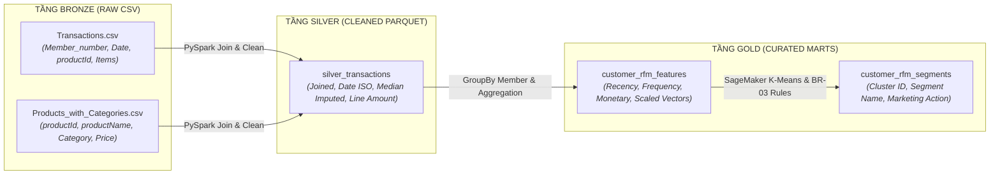

# STTM - ĐẶC TẢ ÁNH XẠ NGUỒN SANG ĐÍCH: HỒ DỮ LIỆU AWS LAKEHOUSE & PHÂN KHÚC KHÁCH HÀNG

> **Dự án**: AWS-Powered Customer Segmentation & ML Pipeline Platform for Retail  
> **Mã hồ sơ**: `STTM-CUST-SEGMENT-AWS-V2`  
> **Phiên bản**: `2.0`  
> **Trạng thái**: `APPROVED`  
> **Tham chiếu SRS**: `SRS-CUST-SEGMENT-AWS-V2`  
> **Tác giả (BA)**: Senior Technical BA & AWS Cloud Solutions Architect  
> **Người duyệt**: Data Engineering Lead & MLOps Architect  
> **Ngày phê duyệt**: 2026-10-15  

### Nhật ký Thay đổi Phiên bản (Revision History)
| Phiên bản | Ngày | Người sửa | Tóm tắt các thay đổi | Mục sửa đổi | Lý do |
| :--- | :--- | :--- | :--- | :--- | :--- |
| `1.0` | 2026-10-15 | Senior BA | Ánh xạ cột cơ bản giữa 2 file CSV sang bảng phân cụm | Toàn bộ | Phiên bản baseline ban đầu |
| `2.0` | 2026-10-15 | Senior BA & Cloud Architect | Mở rộng cấu trúc ánh xạ Medallion 3 tầng: Bronze (Raw CSV) -> Silver (Cleaned Parquet) -> Gold (RFM Features cho SageMaker & Segmented Results cho Athena) | Toàn bộ | Chuẩn hóa theo kiến trúc AWS Data Lakehouse & MLOps |

---

## 1. NGUYÊN TẮC HỢP NHẤT & MÔ HÌNH DỮ LIỆU LAKEHOUSE (LAKEHOUSE DATA MODEL)

Hệ thống tuân thủ kiến trúc **S3 Medallion Lakehouse** với cấu trúc 3 tầng phân định ranh giới rõ ràng:

1. **Tầng Bronze (`s3://retail-lakehouse/bronze/`)**:
   - `raw_transactions/`: Lưu trữ nguyên vẹn `Transactions.csv` (Mỗi dòng = 1 sản phẩm trong giao dịch).
   - `raw_products/`: Lưu trữ nguyên vẹn `Products_with_Categories.csv` (Mỗi dòng = 1 sản phẩm danh mục).
2. **Tầng Silver (`s3://retail-lakehouse/silver/transactions/`)**:
   - Định dạng Apache Parquet nén Snappy, phân vùng theo `year=YYYY/month=MM`.
   - Kết nối (Join) giao dịch với danh mục sản phẩm, chuẩn hóa định dạng thời gian ISO `YYYY-MM-DD`, điền giá thiếu bằng giá trung vị ngành hàng (`category_median_price`).
3. **Tầng Gold (`s3://retail-lakehouse/gold/`)**:
   - `rfm_features/`: Bảng đặc trưng cấp khách hàng (`Member_number`) đã chuẩn hóa (`StandardScaler`) sẵn sàng làm đầu vào cho SageMaker Training & Batch Transform.
   - `customer_segments/`: Bảng kết quả phân cụm học máy kết hợp quy tắc nghiệp vụ, đăng ký vào Glue Data Catalog và truy vấn qua Amazon Athena.

---

## 2. MA TRẬN ÁNH XẠ CỘT TẦNG SILVER: BRONZE $\to$ SILVER (`silver_transactions`)

| STT | Bảng Nguồn (Bronze) | Cột Nguồn | Kiểu Nguồn | Bảng Đích (Silver) | Cột Đích | Kiểu Đích | Null? | Logic Chuyển Đổi & Quy Chuẩn (PySpark / Glue Logic) |
| :---: | :--- | :--- | :--- | :--- | :--- | :--- | :---: | :--- |
| **01** | `Transactions` | `Member_number` | STRING / INT | `silver_transactions` | `member_number` | VARCHAR(32) | N | `TRIM(CAST(Member_number AS STRING))`. Lọc bỏ bản ghi null. |
| **02** | `Transactions` | `Date` | STRING | `silver_transactions` | `transaction_date`| DATE | N | `TO_DATE(Date, 'dd-MM-yyyy')`. Ép kiểu chuẩn ISO `YYYY-MM-DD`. |
| **03** | `Transactions` | `Date` | STRING | `silver_transactions` | `year` | INT | N | `YEAR(transaction_date)`. Cột phân vùng (Partition key 1). |
| **04** | `Transactions` | `Date` | STRING | `silver_transactions` | `month` | INT | N | `LPAD(MONTH(transaction_date), 2, '0')`. Phân vùng (Partition key 2). |
| **05** | `Transactions` | `productId` | STRING | `silver_transactions` | `product_id` | VARCHAR(64) | N | `TRIM(productId)`. Khóa ngoại liên kết bảng sản phẩm. |
| **06** | `Transactions` | `Items` | STRING | `silver_transactions` | `item_description`| VARCHAR(255)| Y | `TRIM(Items)`. Tên mô tả mặt hàng thô từ hệ thống POS. |
| **07** | `Products` | `productName` | STRING | `silver_transactions` | `product_name` | VARCHAR(255)| Y | `COALESCE(TRIM(Products.productName), TRIM(Transactions.Items))`. |
| **08** | `Products` | `Category` | STRING | `silver_transactions` | `category` | VARCHAR(64) | N | `COALESCE(TRIM(Products.Category), 'General Grocery')`. |
| **09** | `Products` | `Price` | FLOAT / STR | `silver_transactions` | `unit_price` | DECIMAL(12,2)| N | `COALESCE(CAST(Price AS DECIMAL(12,2)), category_median_price, 15000.00)`. |
| **10** | *Phái sinh* | *Items / Default*| INT | `silver_transactions` | `quantity` | INT | N | Mặc định = 1 cho mỗi dòng sản phẩm quét mã vạch. |
| **11** | *Phái sinh* | *Calculated* | DECIMAL | `silver_transactions` | `line_total_amount`| DECIMAL(12,2)| N | `unit_price * quantity`. Tổng tiền của từng dòng mặt hàng. |
| **12** | *Hệ thống* | *Audit* | TIMESTAMP | `silver_transactions` | `etl_processed_at`| TIMESTAMP | N | `CURRENT_TIMESTAMP()`. Thời điểm chạy PySpark Glue Job. |

---

## 3. MA TRẬN ÁNH XẠ CỘT TẦNG GOLD: SILVER $\to$ GOLD (`customer_rfm_segments`)

Bảng kết quả cuối cùng phục vụ phòng Marketing và hệ thống báo cáo Amazon Athena / QuickSight:

| STT | Bảng Nguồn (Silver / ML) | Cột Nguồn | Kiểu Nguồn | Bảng Đích (Gold Athena) | Cột Đích | Kiểu Đích | Null? | Logic Chuyển Đổi & Công Thức Chi Tiết |
| :---: | :--- | :--- | :--- | :--- | :--- | :--- | :---: | :--- |
| **01** | `silver_transactions` | `member_number` | VARCHAR | `customer_rfm_segments` | `member_number` | VARCHAR(32) | N | `member_number`. Khóa chính duy nhất đại diện cho 1 khách hàng. |
| **02** | `silver_transactions` | `transaction_date`| DATE | `customer_rfm_segments` | `recency_days` | INT | N | `DATEDIFF(day, MAX(transaction_date), global_max_date)`. Số ngày từ lần mua cuối. |
| **03** | `silver_transactions` | `transaction_date`| DATE | `customer_rfm_segments` | `frequency_count` | INT | N | `COUNT(DISTINCT transaction_date)`. Tổng số ngày mua sắm. |
| **04** | `silver_transactions` | `line_total_amount`| DECIMAL | `customer_rfm_segments` | `monetary_total` | DECIMAL(12,2)| N | `SUM(line_total_amount)`. Tổng số tiền chi tiêu lũy kế. |
| **05** | *Phái sinh Tứ phân vị* | `recency_days` | INT | `customer_rfm_segments` | `r_score` | INT | N | `NTILE(4) OVER (ORDER BY recency_days DESC)`. Đảo chiều: Mới mua = 4, Lâu = 1. |
| **06** | *Phái sinh Tứ phân vị* | `frequency_count` | INT | `customer_rfm_segments` | `f_score` | INT | N | `NTILE(4) OVER (ORDER BY frequency_count ASC)`. Mua nhiều = 4, Mua ít = 1. |
| **07** | *Phái sinh Tứ phân vị* | `monetary_total` | DECIMAL | `customer_rfm_segments` | `m_score` | INT | N | `NTILE(4) OVER (ORDER BY monetary_total ASC)`. Tiêu nhiều = 4, Tiêu ít = 1. |
| **08** | *Ghép chuỗi RFM* | `r, f, m score` | INT | `customer_rfm_segments` | `rfm_class` | VARCHAR(8) | N | `CONCAT(CAST(r_score AS VARCHAR), CAST(f_score AS VARCHAR), CAST(m_score AS VARCHAR))`. |
| **09** | **SageMaker Batch** | `cluster_label` | INT | `customer_rfm_segments` | `cluster_id` | INT | N | Cụm phân loại dự báo từ mô hình K-Means trên Amazon SageMaker (0 đến 4). |
| **10** | *Quy tắc Nghiệp vụ* | `rfm_class` & `cluster_id`| VARCHAR / INT| `customer_rfm_segments` | `segment_name` | VARCHAR(32) | N | **Gán nhãn kinh doanh chuẩn hóa BR-03**: • Cụm R cao, F cao, M cao $\to$ **Champions** • Cụm F cao, M cao, R vừa $\to$ **Loyal Customers** • Cụm R cao, F thấp, M thấp $\to$ **Promising / New** • Cụm R thấp, F cao, M cao $\to$ **At Risk** • Cụm R thấp, F thấp, M thấp $\to$ **Lost / Hibernating** |
| **11** | *Quy tắc Tiếp thị* | `segment_name` | VARCHAR | `customer_rfm_segments` | `marketing_action` | VARCHAR(255)| N | Khuyến nghị tiếp thị cá nhân hóa (Gửi quà VIP, Voucher kích cầu, v.v.). |
| **12** | *MLOps Metadata* | *SageMaker SDK* | STRING | `customer_rfm_segments` | `model_version` | VARCHAR(32) | N | Định danh phiên bản mô hình SageMaker (ví dụ: `kmeans-retail-v2-spot`). |
| **13** | *Hệ thống Audit* | *N/A* | TIMESTAMP | `customer_rfm_segments` | `processed_at` | TIMESTAMP | N | `CURRENT_TIMESTAMP()`. Thời điểm cập nhật dữ liệu vào Glue Catalog. |

---

## 4. XỬ LÝ NGOẠI LỆ & QUY TẮC TOÀN VẸN DỮ LIỆU (DATA RECONCILIATION & ANOMALIES)

1. **Bảo toàn 100% Khách hàng Hợp lệ**:
   - Số lượng khách hàng duy nhất trong tầng Gold (`COUNT(DISTINCT member_number)`) phải khớp chính xác 100% với số lượng khách hàng duy nhất có giao dịch trong bảng Bronze (`Transactions.csv`): Đạt đúng **3.898 khách hàng**, không làm thất thoát bất kỳ khách hàng nào.
2. **Xử lý Sản phẩm Chưa Đăng Ký Mã Giá**:
   - Nếu `productId` có trong `Transactions.csv` nhưng không tồn tại trong `Products_with_Categories.csv`, PySpark Job tự động gắn nhãn Category là `'Uncategorized'` và áp dụng mức giá trung vị toàn hệ thống là `15.000 VND`, đồng thời ghi log cảnh báo vào **Amazon CloudWatch Logs**.
3. **Kiểm Soát Giao Dịch Bất Thường (Negative / Zero Values)**:
   - Các dòng giao dịch có `Quantity <= 0` hoặc phát sinh lỗi ngày tháng sai định dạng không thể parse được sẽ được chuyển hướng sang thư mục S3 Quarantine: `s3://retail-lakehouse/quarantine/corrupted_transactions/` để đội ngũ kỹ thuật rà soát.
