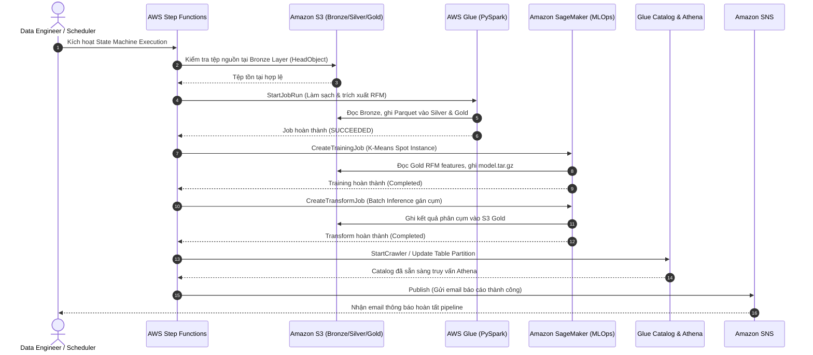

# USER STORIES & USE CASES: NỀN TẢNG AWS DATA & MLOPS PHÂN KHÚC KHÁCH HÀNG

> **Dự án**: AWS-Powered Customer Segmentation & ML Pipeline Platform for Retail  
> **Mã hồ sơ**: `US-UC-CUST-SEGMENT-AWS-V2`  
> **Phiên bản**: `2.0`  
> **Trạng thái**: `APPROVED`  
> **Tham chiếu SRS**: `SRS-CUST-SEGMENT-AWS-V2`  
> **Tác giả (BA)**: Senior Technical BA & AWS Cloud Solutions Architect  
> **Người duyệt**: Product Owner & Lead Data/MLOps Engineer  
> **Ngày phê duyệt**: 2026-10-15  

### Nhật ký Thay đổi Phiên bản (Revision History)
| Phiên bản | Ngày | Người sửa | Tóm tắt các thay đổi | Mục sửa đổi | Lý do |
| :--- | :--- | :--- | :--- | :--- | :--- |
| `1.0` | 2026-10-15 | Senior BA | Khởi tạo 5 User Stories cho hệ thống Free Tier | Toàn bộ | Phiên bản baseline ban đầu |
| `2.0` | 2026-10-15 | Senior BA & Cloud Architect | Nâng cấp 6 User Stories & Use Case phản ánh đầy đủ chu trình AWS Cloud Data & MLOps (S3 Medallion, Glue/EMR PySpark, CodeBuild CI/CD, SageMaker Spot Training, Batch Transform, Step Functions, FinOps Guardrails) | Toàn bộ | Đáp ứng mục tiêu xây dựng & thực hành dự án AWS doanh nghiệp |

---

## 1. DANH SÁCH USER STORIES (CHUẨN INVEST & 100% GHERKIN ACCEPTANCE CRITERIA)

### US-01: Thiết Lập Hồ Dữ Liệu S3 Medallion & Quản Trị Truy Cập IAM
- **Mã User Story**: `US-01`
- **Tiêu đề**: Xây dựng cấu trúc lưu trữ S3 3 tầng (Bronze, Silver, Gold) kèm chính sách bảo mật IAM Least Privilege.
- **Là một (As a)**: Cloud Data Engineer.
- **Tôi muốn (I want to)**: Khởi tạo các S3 Buckets có cấu trúc Medallion, bật mã hóa SSE-S3 và cấp quyền IAM Role tối thiểu cho các dịch vụ AWS.
- **Để mà (So that)**: Toàn bộ dữ liệu giao dịch bán lẻ được lưu trữ an toàn, có tổ chức, sẵn sàng cho các tiến trình xử lý PySpark và SageMaker.
- **Tiêu chuẩn Nghiệm thu (Acceptance Criteria - Gherkin)**:
  ```gherkin
  Scenario: Khởi tạo cấu trúc S3 Medallion và kiểm tra bảo mật
    Given một AWS Account với AWS CLI đã được cấu hình credentials hợp lệ
    When Cloud Engineer thực thi lệnh khởi tạo S3 Buckets cho 3 tầng bronze, silver, gold
    Then các bucket S3 phải được tạo thành công với tính năng Block All Public Access được kích hoạt
    And thuộc tính Server-Side Encryption (SSE-S3) phải ở trạng thái Enabled
    And IAM Execution Role cho AWS Glue và SageMaker chỉ được cấp quyền đọc ghi trên đúng các bucket của dự án.
  ```

---

### US-02: Pipeline Xử Lý Dữ Liệu Lớn & Trích Xuất RFM với Glue / PySpark
- **Mã User Story**: `US-02`
- **Tiêu đề**: Phát triển kịch bản PySpark ETL làm sạch dữ liệu, kết nối danh mục sản phẩm và tính toán chỉ số RFM.
- **Là một (As a)**: Big Data Engineer.
- **Tôi muốn (I want to)**: Triển khai kịch bản PySpark đọc dữ liệu từ Bronze S3, xử lý missing price và tính toán các chỉ số Recency, Frequency, Monetary cho từng khách hàng.
- **Để mà (So that)**: Tạo ra bảng đặc trưng RFM chuẩn hóa tại Gold S3 phục vụ mô hình học máy trên Amazon SageMaker.
- **Tiêu chuẩn Nghiệm thu (Acceptance Criteria - Gherkin)**:
  ```gherkin
  Scenario: Thực thi PySpark ETL trích xuất chỉ số RFM cho toàn bộ khách hàng
    Given dữ liệu thô Transactions.csv và Products_with_Categories.csv đã nằm tại S3 Bronze
    When tiến trình PySpark ETL (Glue Job hoặc Local Spark) được kích hoạt
    Then toàn bộ 3.898 khách hàng hợp lệ phải được trích xuất đủ 3 chỉ số Recency, Frequency và Monetary
    And các giá trị đơn giá thiếu phải được điền bằng giá trung vị của danh mục tương ứng
    And kết quả được ghi ra định dạng Snappy Parquet tại S3 Gold với schema khớp 100% tài liệu STTM.
  ```

---

### US-03: Đóng Gói Tự Động Hóa & CI/CD với AWS CodeBuild
- **Mã User Story**: `US-03`
- **Tiêu đề**: Thiết lập quy trình CI/CD đóng gói Docker Container và kiểm thử tự động với AWS CodeBuild.
- **Là một (As a)**: MLOps / DevOps Engineer.
- **Tôi muốn (I want to)**: Cấu hình tệp `buildspec.yml` để CodeBuild tự động chạy unit tests và đóng gói Docker image chứa thuật toán phân cụm đẩy lên Amazon ECR.
- **Để mà (So that)**: Môi trường huấn luyện mô hình trên SageMaker luôn nhất quán, có khả năng tái lập và tự động hóa triển khai khi có mã nguồn mới.
- **Tiêu chuẩn Nghiệm thu (Acceptance Criteria - Gherkin)**:
  ```gherkin
  Scenario: Tự động build và push container image lên Amazon ECR
    Given mã nguồn dự án và tệp buildspec.yml đã được commit
    When một phiên CodeBuild Job được kích hoạt
    Then toàn bộ các bài kiểm tra Unit Tests trong thư mục tests/ phải vượt qua với tỷ lệ thành công 100%
    And một Docker image chuẩn OCI được biên dịch thành công
    And Docker image được đẩy lên Amazon ECR repository retail-customer-segmentation:latest trong vòng dưới 5 phút.
  ```

---

### US-04: SageMaker MLOps Pipeline Huấn Luyện K-Means với Spot Instances
- **Mã User Story**: `US-04`
- **Tiêu đề**: Huấn luyện mô hình K-Means trên Amazon SageMaker sử dụng Managed Spot Instances để tối ưu chi phí.
- **Là một (As a)**: Machine Learning Engineer.
- **Tôi muốn (I want to)**: Sử dụng SageMaker Python SDK để kích hoạt Training Job với cờ `use_spot_instances=True` trên dữ liệu đặc trưng RFM từ S3 Gold.
- **Để mà (So that)**: Tìm ra số cụm tối ưu ($K=5$) dựa trên Silhouette Score, xuất artifact `model.tar.gz` mà tiết kiệm đến 70% chi phí điện toán.
- **Tiêu chuẩn Nghiệm thu (Acceptance Criteria - Gherkin)**:
  ```gherkin
  Scenario: Huấn luyện mô hình K-Means trên SageMaker với Spot Instance
    Given bảng đặc trưng RFM đã sẵn sàng tại s3://retail-lakehouse/gold/rfm_features/
    When lệnh SageMaker Training Job được kích hoạt với tùy chọn use_spot_instances=True
    Then phiên huấn luyện phải hoàn thành thành công trong thời gian dưới 6 phút
    And hệ số Silhouette Score đạt mức tối ưu cho 5 cụm phân loại
    And tệp model.tar.gz chứa trọng tâm các cụm (Centroids) được lưu thành công vào S3 Model Registry.
  ```

---

### US-05: Suy Luận Phân Cụm Batch Transform & Phục Vụ Truy Vấn Athena
- **Mã User Story**: `US-05`
- **Tiêu đề**: Gán nhãn phân khúc khách hàng hàng loạt bằng SageMaker Batch Transform và tạo bảng Athena.
- **Là một (As a)**: Marketing Analyst / Business User.
- **Tôi muốn (I want to)**: Hệ thống tự động gán nhãn cụm (Champions, Loyal, Promising, At-Risk, Lost) cho từng khách hàng và cho phép tôi dùng SQL truy vấn trên Amazon Athena.
- **Để mà (So that)**: Tôi có thể lọc ngay danh sách số điện thoại/mã thành viên nhóm VIP hoặc At-Risk để triển khai chiến dịch tiếp thị mà không cần chờ đợi đội kỹ thuật.
- **Tiêu chuẩn Nghiệm thu (Acceptance Criteria - Gherkin)**:
  ```gherkin
  Scenario: Gán nhãn phân khúc qua Batch Transform và truy vấn bằng Athena
    Given mô hình SageMaker đã được huấn luyện xong và lưu tại S3
    When SageMaker Batch Transform Job chạy xong và bảng Glue Catalog được cập nhật
    Then bảng customer_rfm_segments trong Athena phải chứa đủ 3.898 khách hàng
    And mỗi khách hàng được gán chính xác 1 trong 5 nhãn phân khúc nghiệp vụ
    And câu lệnh SQL SELECT * WHERE segment_name = 'Champions' trả về kết quả trong thời gian dưới 3 giây.
  ```

---

### US-06: Điều Phối State Machine với Step Functions & Chốt Chặn FinOps
- **Mã User Story**: `US-06`
- **Tiêu đề**: Tự động hóa toàn bộ luồng xử lý bằng AWS Step Functions kết hợp giám sát ngân sách CloudWatch Alarms.
- **Là một (As a)**: Cloud Architect & FinOps Specialist.
- **Tôi muốn (I want to)**: Đóng gói toàn bộ các bước thành một State Machine duy nhất và cài đặt CloudWatch Billing Alarm ở ngưỡng 1.00 USD.
- **Để mà (So that)**: Pipeline vận hành tự động từ đầu đến cuối một cách tin cậy và không bao giờ vượt quá ngân sách thực hành cho phép ($\le 5.00$ USD).
- **Tiêu chuẩn Nghiệm thu (Acceptance Criteria - Gherkin)**:
  ```gherkin
  Scenario: Chạy toàn bộ State Machine và kiểm tra cơ chế FinOps
    Given AWS Step Functions State Machine đã được định nghĩa bằng JSON ASL
    When State Machine được kích hoạt với tham số đầu vào của batch dữ liệu mới
    Then các bước Ingestion -> Glue ETL -> SageMaker Training/Batch -> Catalog Update phải tuần tự hoàn thành ở trạng thái Succeeded
    And CloudWatch Billing Alarm được kích hoạt sẵn sàng gửi cảnh báo nếu chi phí AWS vượt ngưỡng 1.00 USD
    And không có bất kỳ máy chủ EC2 hay SageMaker Endpoint nào bị treo chạy ngầm sau khi State Machine kết thúc.
  ```

---

## 2. ĐẶC TẢ TRƯỜNG HỢP SỬ DỤNG (USE CASE SPECIFICATION)

### Use Case UC-01: Vận Hành Tự Động Hóa Chu Trình AWS Data & MLOps Pipeline
- **Tên Use Case**: `UC-01 - End-to-End Execution of AWS Data & MLOps Pipeline`
- **Mã tham chiếu**: `UC-CUST-SEGMENT-01`
- **Tác nhân chính (Primary Actor)**: Data Engineer / Automated Event Scheduler (Amazon EventBridge).
- **Tác nhân phụ (Supporting Actors)**: AWS Step Functions, AWS Glue, Amazon SageMaker, Amazon Athena, Amazon SNS.
- **Điều kiện tiên quyết (Pre-conditions)**:
  1. File dữ liệu giao dịch mới đã được tải lên S3 Bronze.
  2. IAM Execution Roles cho Step Functions, Glue và SageMaker đã được cấu hình đầy đủ quyền hạn.
  3. CloudWatch Billing Alarm đang hoạt động bình thường.
- **Điều kiện sau khi hoàn thành (Post-conditions)**:
  1. Toàn bộ 3.898 khách hàng được cập nhật nhãn phân khúc mới nhất tại S3 Gold.
  2. Glue Data Catalog cập nhật bảng `customer_rfm_segments`.
  3. Toàn bộ tài nguyên tính toán tạm thời (Glue workers, SageMaker spot instances) đã tự động tắt.
  4. Email thông báo kết quả thành công được gửi qua Amazon SNS.

#### Luồng Sự Kiện Chính (Main Success Scenario):


#### Luồng Ngoại Lệ (Exception Flows):
- **E-01 (Tệp Nguồn Không Hợp Lệ tại Bước 2)**:
  * Nếu S3 báo tệp rỗng hoặc sai cấu trúc $\to$ Step Functions chuyển sang trạng thái `FailJob`, gửi cảnh báo khẩn cấp qua SNS tới Data Engineer và dừng toàn bộ chu trình, không kích hoạt Glue hay SageMaker để chống lãng phí chi phí.
- **E-02 (SageMaker Spot Instance Bị Thu Hồi tại Bước 7)**:
  * Nếu AWS thu hồi Spot Instance do biến động tài nguyên thị trường $\to$ Cơ chế Retry của Step Functions tự động thử lại sau 2 phút hoặc chuyển sang chế độ On-Demand với giới hạn thời gian chạy tối đa `max_run = 600` giây.

---

## 3. MA TRẬN TRUY VẾT YÊU CẦU 100% (TRACEABILITY MATRIX - RTM)

| Mục Tiêu BRD | Yêu Cầu SRS | User Story | Use Case | Kịch Bản Kiểm Thử | Dịch Vụ AWS Thực Thi | Trạng Thái |
| :---: | :---: | :---: | :---: | :---: | :--- | :---: |
| **BO-01, TO-01** | `FR-01` | `US-01` | `UC-01` | `TC-UAT-01` | Amazon S3 & IAM Policies | **COVERED 100%** |
| **BO-01, TO-01** | `FR-02` | `US-02` | `UC-01` | `TC-UAT-02` | AWS Glue / EMR PySpark | **COVERED 100%** |
| **TO-02** | `FR-03` | `US-03` | `UC-01` | `TC-UAT-03` | AWS CodeBuild & Amazon ECR | **COVERED 100%** |
| **BO-01, TO-02** | `FR-04` | `US-04` | `UC-01` | `TC-UAT-04` | Amazon SageMaker Spot Training | **COVERED 100%** |
| **BO-02, BO-03** | `FR-05, FR-06`| `US-05` | `UC-01` | `TC-UAT-05` | SageMaker Batch Transform & Athena | **COVERED 100%** |
| **TO-01, TO-03** | `FR-07, NFR-01`| `US-06` | `UC-01` | `TC-UAT-06` | Step Functions & CloudWatch Alarms | **COVERED 100%** |
