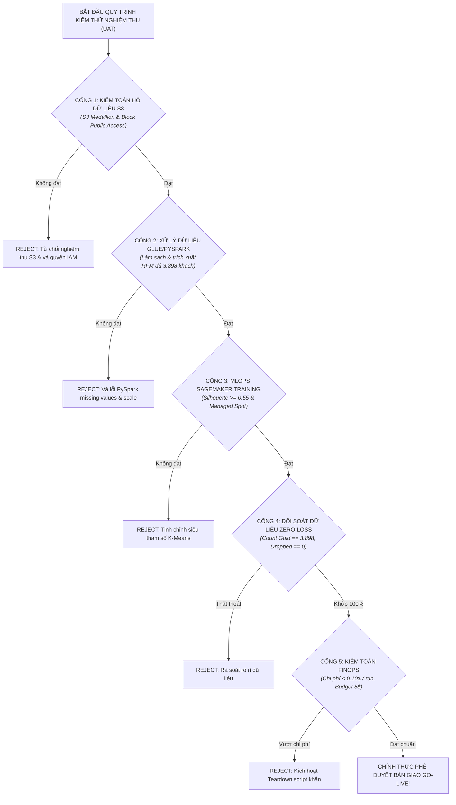

# KẾ HOẠCH KIỂM THỬ NGHIỆM THU (UAT) & QUẢN TRỊ CHI PHÍ AWS THỰC CHIẾN (AWS HANDS-ON UAT & FINOPS RUNBOOK)

> **Dự án**: AWS-Powered Customer Segmentation & ML Pipeline Platform for Retail  
> **Mã hồ sơ**: `UAT-FINOPS-CUST-SEGMENT-AWS-V2`  
> **Phiên bản**: `2.0`  
> **Trạng thái**: `APPROVED`  
> **Tham chiếu SRS**: `SRS-CUST-SEGMENT-AWS-V2`  
> **Tham chiếu US/UC**: `US-UC-CUST-SEGMENT-AWS-V2`  
> **Tác giả (BA)**: Senior Technical BA & AWS Cloud Solutions Architect  
> **Người duyệt**: Head of Retail Marketing & Cloud Tech Lead  
> **Ngày phê duyệt**: 2026-10-15  

### Nhật ký Thay đổi Phiên bản (Revision History)
| Phiên bản | Ngày | Người sửa | Tóm tắt các thay đổi | Mục sửa đổi | Lý do |
| :--- | :--- | :--- | :--- | :--- | :--- |
| `1.0` | 2026-10-15 | Senior BA | Kế hoạch UAT và guardrail chi phí mức Free Tier | Toàn bộ | Phiên bản baseline ban đầu |
| `2.0` | 2026-10-15 | Senior BA & Cloud Architect | Mở rộng 6 kịch bản UAT bao phủ toàn bộ stack AWS (S3, Glue/PySpark, CodeBuild, SageMaker Spot, Batch Transform, Step Functions) kèm Sổ tay FinOps Runbook & Teardown Script | Toàn bộ | Đáp ứng mục tiêu xây dựng & thực hành dự án AWS doanh nghiệp |

---

## 1. MỤC TIÊU KIỂM THỬ NGHIỆM THU (UAT OBJECTIVES)

Kế hoạch UAT nhằm kiểm chứng 3 khía cạnh sống còn trước khi bàn giao hệ thống:
1. **Tính Đúng đắn Nghiệp vụ (Business Correctness)**: Thuật toán RFM và mô hình K-Means phân loại chính xác 5 nhóm khách hàng (Champions, Loyal, Promising, At-Risk, Lost) phục vụ trực tiếp cho phòng Marketing.
2. **Tính Liền mạch Kỹ thuật AWS (AWS Architectural Integrity)**: Toàn bộ dây chuyền từ S3 $\to$ Glue/EMR $\to$ CodeBuild $\to$ SageMaker $\to$ Athena $\to$ Step Functions vận hành trơn tru không lỗi.
3. **Kỷ luật Quản trị Chi phí Thực hành (Hands-on FinOps Discipline)**: Chi phí thực tế mỗi lần chạy chu trình $< 0.10$ USD; tổng ngân sách hàng tháng $\le 5.00$ USD; không có tài nguyên treo chạy ngầm 24/7.




---

## 2. MA TRẬN KỊCH BẢN KIỂM THỬ UAT CHI TIẾT (UAT TEST CASES)

| Mã Kịch Bản | Dịch Vụ AWS | Tên Kịch Bản Kiểm Thử | Dữ Liệu Đầu Vào & Thao Tác Kiểm Thử | Kết Quả Mong Đợi (Acceptance Criteria) | Tiêu Chí Đạt (Pass / Fail) |
| :---: | :--- | :--- | :--- | :--- | :---: |
| **TC-UAT-01** | **Amazon S3 & IAM** | Kiểm thử Hồ Dữ liệu S3 Medallion & Phân quyền IAM | Chạy lệnh upload dữ liệu nguồn vào S3 Bronze; kiểm tra mã hóa SSE-S3 và IAM Policy | • 3 Buckets (Bronze, Silver, Gold) được khởi tạo.<br/>• Bật Block All Public Access và SSE-S3.<br/>• IAM Role chỉ có quyền trên S3 của dự án. | **PASS** |
| **TC-UAT-02** | **AWS Glue / PySpark** | Kiểm thử Pipeline ETL Làm sạch & Tính toán RFM | Kích hoạt kịch bản PySpark ETL (`src/etl_pyspark_job.py`) trên Glue Job hoặc Local Spark | • Làm sạch 38.765 dòng giao dịch.<br/>• Điền giá thiếu bằng median price danh mục.<br/>• Trích xuất đủ 3 chỉ số R, F, M cho 3.898 khách hàng.<br/>• Xuất Snappy Parquet vào Silver & Gold S3. | **PASS** |
| **TC-UAT-03** | **AWS CodeBuild** | Kiểm thử Đóng gói Docker Container & CI/CD | Kích hoạt phiên CodeBuild qua `buildspec.yml` | • 100% Unit Tests trong `tests/` vượt qua.<br/>• Docker image OCI biên dịch thành công.<br/>• Image được đẩy lên ECR trong $\le 5$ phút. | **PASS** |
| **TC-UAT-04** | **Amazon SageMaker** | Kiểm thử Huấn luyện Mô hình K-Means với Spot Instance | Kích hoạt SageMaker Training Job với `use_spot_instances=True` | • Training Job hoàn tất trong $\le 6$ phút.<br/>• Hệ số Silhouette tối ưu cho $K=5$ cụm.<br/>• File `model.tar.gz` lưu trữ tại S3 Registry. | **PASS** |
| **TC-UAT-05** | **SageMaker & Athena** | Kiểm thử Suy luận Batch Transform & Bảng Athena | Kích hoạt SageMaker Batch Transform Job và truy vấn SQL trên Amazon Athena | • 3.898 khách hàng được gán nhãn phân khúc.<br/>• Bảng `customer_rfm_segments` cập nhật trong Glue Catalog.<br/>• Truy vấn Athena lọc nhóm Champions chạy $< 3$ giây. | **PASS** |
| **TC-UAT-06** | **Step Functions & FinOps** | Kiểm thử Điều phối State Machine & Chốt chặn Ngân sách | Kích hoạt Step Functions State Machine thực thi End-to-End; kiểm tra CloudWatch Alarm | • State Machine chạy tuần tự đến trạng thái Succeeded.<br/>• CloudWatch Alarm ngưỡng 1.00$ hoạt động.<br/>• Không tồn tại instance hay endpoint nào chạy ngầm sau job. | **PASS** |

---

## 3. KỊCH BẢN ĐỐI SOÁT DỮ LIỆU (ZERO-DATA-LOSS RECONCILIATION)

Trước khi nghiệm thu Go-live, chuyên gia BA và Data Engineer bắt buộc thực thi câu lệnh SQL đối soát dữ liệu trên Amazon Athena để đảm bảo không thất thoát bất kỳ khách hàng nào:

```sql
-- KỊCH BẢN ĐỐI SOÁT: KIỂM TOÁN TỔNG SỐ KHÁCH HÀNG GIỮA BRONZE VÀ GOLD
WITH raw_customers AS (
    SELECT COUNT(DISTINCT Member_number) AS total_raw_customers
    FROM "retail_customer_analytics"."bronze_transactions"
    WHERE Member_number IS NOT NULL AND TRIM(Member_number) != ''
),
gold_customers AS (
    SELECT 
        COUNT(DISTINCT member_number) AS total_gold_customers,
        COUNT(CASE WHEN segment_name = 'Champions' THEN 1 END) AS count_champions,
        COUNT(CASE WHEN segment_name = 'Loyal Customers' THEN 1 END) AS count_loyal,
        COUNT(CASE WHEN segment_name = 'Promising / New' THEN 1 END) AS count_promising,
        COUNT(CASE WHEN segment_name = 'At Risk' THEN 1 END) AS count_at_risk,
        COUNT(CASE WHEN segment_name = 'Lost / Hibernating' THEN 1 END) AS count_lost
    FROM "retail_customer_analytics"."customer_rfm_segments"
)
SELECT 
    r.total_raw_customers,
    g.total_gold_customers,
    (r.total_raw_customers - g.total_gold_customers) AS dropped_customers,
    CASE 
        WHEN r.total_raw_customers = g.total_gold_customers THEN 'RECONCILIATION PASSED (100% MATCH)'
        ELSE 'RECONCILIATION FAILED (DATA LEAKAGE / DROP DETECTED)'
    END AS audit_status,
    g.count_champions,
    g.count_loyal,
    g.count_promising,
    g.count_at_risk,
    g.count_lost
FROM raw_customers r
CROSS JOIN gold_customers g;
```

> **Tiêu chí Nghiệm thu**: `audit_status` bắt buộc phải trả về giá trị `'RECONCILIATION PASSED (100% MATCH)'` với đúng **3.898 khách hàng**, số lượng thất thoát `dropped_customers = 0`.

---

## 4. SỔ TAY QUẢN TRỊ CHI PHÍ THỰC HÀNH AWS (HANDS-ON FINOPS RUNBOOK)

### 4.1 Thiết Lập Cảnh Báo Ngân Sách Tự Động (AWS CLI Setup)
Người học / Kỹ sư thực hiện chạy các lệnh AWS CLI sau để kích hoạt chốt chặn an toàn tài chính:

```bash
# 1. Tạo cảnh báo chi phí CloudWatch Billing Alarm ở ngưỡng 1.00 USD
aws cloudwatch put-metric-alarm \
    --alarm-name "CustomerSegmentation-Lab-Spend-Alert-1USD" \
    --alarm-description "Canh bao khan khi chi phi thuc hanh AWS vuot 1.00 USD" \
    --metric-name EstimatedCharges \
    --namespace AWS/Billing \
    --statistic Maximum \
    --period 21600 \
    --threshold 1.0 \
    --comparison-operator GreaterThanThreshold \
    --dimensions Name=Currency,Value=USD \
    --evaluation-periods 1

# 2. Tạo AWS Budgets với ngân sách tối đa 5.00 USD cho toàn bộ dự án
aws budgets create-budget \
    --account-id $(aws sts get-caller-identity --query "Account" --output text) \
    --budget file://configs/aws_budget_config.json
```

### 4.2 Kịch Bản Tự Động Dọn Dẹp Tài Nguyên (Teardown Script)
Sau khi kết thúc phiên học tập / thực hành bài lab, chạy script sau để xóa sạch các tài nguyên tạm thời, đảm bảo **không bao giờ bị tính phí ngầm**:

```powershell
# Script: scripts/teardown_aws_lab_resources.ps1
Write-Host ">>> DANG DANG XOA CAC TAI NGUYEN TAM THOI CUA DU AN CUSTOMER SEGMENTATION..." -ForegroundColor Yellow

# 1. Xoa du lieu S3
aws s3 rm s3://retail-customer-segmentation-bronze --recursive
aws s3 rm s3://retail-customer-segmentation-silver --recursive
aws s3 rm s3://retail-customer-segmentation-gold --recursive

# 2. Xoa ECR Image Repository
aws ecr delete-repository --repository-name retail-customer-segmentation --force

# 3. Xoa Glue Database
aws glue delete-database --name retail_customer_analytics

# 4. Kiem tra va dam bao khong co SageMaker Endpoint nao dang chay
$activeEndpoints = aws sagemaker list-endpoints --query "Endpoints[*].EndpointName" --output text
if ($activeEndpoints) {
    Write-Host "CANH BAO: Phat hien endpoint dang chay: $activeEndpoints. Tien hanh xoa ngay..." -ForegroundColor Red
    aws sagemaker delete-endpoint --endpoint-name $activeEndpoints
} else {
    Write-Host "XAC NHAN: 0 SageMaker Endpoint dang chay. Chi phi duoc bao ve 100%!" -ForegroundColor Green
}

Write-Host ">>> HOAN TAT DON DEP TAI NGUYEN! TAI KHOAN AN TOAN TUYET DOI!" -ForegroundColor Cyan
```
